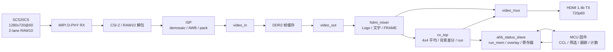
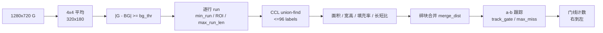

# camera_hdmi_720p

PH1P35MDG324（HX1P35A 开发板）上的 SC520CS 摄像头钢珠检测工程。摄像头图像经过 MIPI、ISP、DDR2 帧缓存和 HDMI 输出，FPGA 完成像素级前端与画面叠加，MCU 完成连通域分析、跟踪、门线计数和参数管理。

## 发布产物

| 项目 | 文件 | MD5 |
|---|---|---|
| bit | `artifacts/camera_hdmi_720p_ae_mcu_E93577E7.bit` | `E93577E71A445D475698BA80A714343B` |
| ELF | `artifacts/ph1p35_status_tune_gate100_E6DFDDC8.elf` | `E6DFDDC8E784C607C1192C3459FC97DF` |

最终时序与资源：

```text
Setup WNS +0.140 ns
Hold  WNS +0.020 ns
0 violations
Slices 16,940 / 21,216 (79.85%)
RAM    69 / 108
DSP    10 / 40
```

上板时需要同时加载 bit 和 ELF。只更换 ELF 可以调整检测参数，不需要重新综合 FPGA。

## 系统结构



摄像头链路固定为 1280×720@60。检测在 320×180 小图上运行，4×4 块平均使用 G 通道。

## 工作模式

| SW1 | SW2 | 画面 | 说明 |
|---|---|---|---|
| 0 | × | 识别画面 | 摄像头 + 绿框 + 完整 UI + 门线 |
| 1 | 0 | 静态测试图案 | 彩条、灰度渐变、移动方块、MiSans 文字 |
| 1 | 1 | 动态调试 | K1 短按循环 RGB / score / mask |

按键：

| 按键 | 功能 |
|---|---|
| K1 短按 | 仅在 `SW1=1, SW2=1` 时循环 RGB / score / mask |
| K1 长按 ≥1 s | 清零 Count、BCD、绿框和全部轨迹 |
| K2 长按 ≥1 s | 重新采集背景；数码管显示 `--------`，直到新背景就绪 |
| K3 / K4 | 遗留阈值脉冲，当前 RTL 不消费，无实际作用 |

## 识别画面 UI

| 元素 | 位置 | 尺寸 | 内容 |
|---|---|---|---|
| Logo | `(24,24)` | 160×160 | 安路 Logo |
| 赛事文本 | `(24,172)` | 160×24 | `Anlogic HX1P35A` |
| 当前球数 | `(184,652)` | 112×20 | `DETECTED N`，N=0..8 |
| 计数标题 | `(24,612)` | 160×18 | `STEEL BALL` |
| Count | `(24,638)` | 150×34 | 5 位十进制，左为万位 |
| 帧计数 | `(24,680)` | 240×20 | `FRAME 000123` |
| 门线 | `x=400` | 2 px 宽 | 红色 `#FF3366`，`y=0..720` |

所有可见文字使用 MiSans Medium 1-bit ROM：

```text
STEEL BALL        160x18
Anlogic HX1P35A   160x24
FRAME 前缀         80x20
帧数字             16x20
Count             30x34
球框 ID            8x12
DETECTED 前缀      96x20
DETECTED 数字      16x20
测试图案文字       288x20
```

7 段数码管显示右侧 5 位 Count，左侧 3 位熄灭。K2 重采背景期间 8 位全部显示 `-`。

## 检测算法



当前参数摘要：

```text
bg_thr=80          min_run=2
min_area=100       max_area=2000
min_w=18           max_w=100
min_h=5            max_h=50
merge_dist=20      max_run_len=200
box_w_small=43
gate_x=100         gate_y0=0       gate_y1=180
roi_y1=180
track_gate=55      max_miss=5
min_hits=2         min_move=5
min_window=21      vx_max=-1
```

只有可见轨迹从右向左穿过门线才计数，反方向不计。背景采用单帧快照，光照或场景变化后通过 K2 重采。

## 相机曝光与增益

曝光和增益由 MCU 控制，不再使用 N2/J14 按键。

```text
CAM_AE = 768  半行，约 6.4 ms
CAM_AG = 64
```

寄存器：

| 偏移 | 名称 | 说明 |
|---:|---|---|
| `0x60` | `CAM_AE` | 曝光目标，2..1991 半行 |
| `0x64` | `CAM_AG` | 增益目标，16..176；小于 16 时按 16 处理 |

修改 `main.c` 中的 `VISION_PARAMS.exposure` 或 `VISION_PARAMS.gain` 后重新编译 ELF 即可。

## AHB 寄存器

MCU 通过 AHB 窗口 `0x8000_0000 + offset` 访问。

| 偏移 | 名称 | 方向 | 说明 |
|---:|---|---|---|
| `0x00` | `CAM_REG` | R | 摄像头与板级状态 |
| `0x04` | `CV_REG` | R | `bin_thr`、run_cnt、帧计数低 8 位 |
| `0x08` | `FRAME_REG` | R | vsync 帧计数 |
| `0x0C` | `VER_REG` | R | `0x4D435602` |
| `0x10` | `HEARTBEAT` | W | MCU 心跳 |
| `0x14` | `SCRATCH` | R/W | 调试暂存 |
| `0x18` | `RUN_IDX` | W | run_mem 读索引 |
| `0x1C` | `RUN_DAT` | R | run_mem 数据 |
| `0x20` | `OV_IDX` | W | overlay 索引 0..7 |
| `0x24` | `OV_W0` | W | overlay 高 32 位 |
| `0x28` | `OV_W1` | W | overlay 低 32 位，写入提交 |
| `0x2C` | `META_REG` | R | run_cnt、min_y、max_y |
| `0x30` | `OV_COUNT` | W | 计数值 |
| `0x34` | `BALL_CTRL` | W | `[0]=enable [1]=capture` |
| `0x38` | `BALL_THR` | W | `[7:0]=bg_thr [15:8]=min_run` |
| `0x3C` | `BALL_STATUS` | R | `[0]=bg_ready [1]=capturing [2]=run_overflow` |
| `0x40` | `SW_STAT` | R | `[0]=SW1 [1]=SW2 [2]=SW3 [3]=SW4` |
| `0x44` | `BCD_COUNT` | W | 5 位 BCD 计数 |
| `0x48` | `BALL_RUN_CFG` | W | `[8:0]=roi_y1 [19:10]=max_run_len` |
| `0x4C` | `SKIP_CNT` | R | `[15:0]=ROI 丢弃 run [31:16]=超长 run 丢弃` |
| `0x50` | `KEY_EVT` | R/W | `[0]=K1 长按 [1]=K2 长按`，写 1 清零 |
| `0x54` | `BALL_NOW` | W | 当前绿框数 0..8 |
| `0x58` | `SEG_CTRL` | W | `[0]=1` 时数码管全部显示 `-` |
| `0x5C` | `BALL_GATE` | W | `[8:0]=gate_x [16:9]=gate_y0 [24:17]=gate_y1` |
| `0x60` | `CAM_AE` | W | 曝光目标 |
| `0x64` | `CAM_AG` | W | 增益目标 |

## 构建

### MCU 固件

```powershell
cd work\camera_hdmi_720p
powershell -ExecutionPolicy Bypass -File tools\sync_fw.ps1

$env:Path='D:\Anlogic\FD_Release_2026.2\toolchain\build-tools\bin;D:\Anlogic\FD_Release_2026.2\toolchain\gcc\riscv\ph1p35\bin;'+$env:Path
make -C C:/Users/Z___C/FDWork/ph1p35_status `
  TARGET=ph1p35_status `
  SDK_ROOT=C:/Users/Z___C/FDWork/MCU_startup `
  COMPILE_PREFIX=D:/Anlogic/FD_Release_2026.2/toolchain/gcc/riscv/ph1p35/bin/riscv64-unknown-elf- -j4
```

### FPGA bit

```powershell
cd td_project\camera_hdmi_720p_Runs\syn_1
cmd /c "run.bat < nul"

cd ..\phy_1
cmd /c "run.bat < nul"
```

必须使用命令行运行，TD GUI 会重写 `settings.cfg` 并丢失 DDR IP 约束。新增 RTL 文件后先运行：

```powershell
python tools\td_run\sync_prj.py work\camera_hdmi_720p
```

## 验证

```powershell
cd work\camera_hdmi_720p

powershell -ExecutionPolicy Bypass -File tools\sim\run_iverilog.ps1 -Tb tb_ahb_status_slave
powershell -ExecutionPolicy Bypass -File tools\sim\run_iverilog.ps1 -Tb tb_ae_set
powershell -ExecutionPolicy Bypass -File tools\sim\run_iverilog.ps1 -Tb tb_count_order
powershell -ExecutionPolicy Bypass -File tools\sim\run_iverilog.ps1 -Tb tb_ui_overlay
powershell -ExecutionPolicy Bypass -File tools\sim\run_iverilog.ps1 -Tb tb_seg_count_display
powershell -ExecutionPolicy Bypass -File tools\sim\run_iverilog.ps1 -Tb tb_test_pattern
powershell -ExecutionPolicy Bypass -File tools\sim\run_iverilog.ps1 -Tb tb_cv_ball
powershell -ExecutionPolicy Bypass -File tools\sim\run_iverilog.ps1 -Tb tb_hdmi_logo
```

静态检查：

```powershell
python tools\check_rtl.py .
```

## 性能边界

当前相机配置为 1280×720@60，MIPI 2-lane RAW10，828 Mbps/lane。FPGA 像素通路为 75 MHz 单像素时钟，HDMI 输出固定 720p60。

完整 720p120 需要 148.5 MHz 像素时钟或双像素通路，当前结构不满足。检测 120 fps 可以使用 640×360@120 或 ROI 120 的传感器模式，仍保持 HDMI 60 输出；这需要新的传感器寄存器表和视频输入配置。降低运动拖影依靠缩短曝光时间，当前曝光约 6.4 ms，增加补光后可以继续降低。

## 目录

```text
camera_hdmi_720p/
├─ README.md
├─ docs/
│  ├─ plan.md
│  └─ TECHNICAL_DETAILS.md
├─ rtl/
│  ├─ top/design_top_wrapper.v
│  ├─ cv/cv_top.v
│  ├─ mcu/ahb_status_slave.v
│  ├─ mcu/ps_wrapper.v
│  ├─ video/
│  ├─ camera/
│  └─ isp/
├─ mcu_fw/main.c
├─ constraints/
├─ ip/
├─ tools/
│  ├─ sim/
│  ├─ ui_layout/
│  ├─ vision_demo/
│  ├─ frame_viewer.html
│  ├─ sync_fw.ps1
│  ├─ check_rtl.py
│  └─ td_run/
├─ td_project/
└─ artifacts/
```

## 关联文档

- `docs/TECHNICAL_DETAILS.md`：模块、时钟、数据通路、构建与验证细节
- `docs/plan.md`：最终状态、寄存器、参数和性能边界
- `mcu_fw/README.md`：固件参数、串口协议、调参流程
- `tools/ui_layout/README.md`：OSD 布局编辑器
- `tools/vision_demo/README.md`：参数交互演示
- `docs/hardware/HW_MCU.md`：MCU 平台与 AHB 窗口
- `docs/hardware/HW_SC520CS.md`：SC520CS 摄像头参数
