# camera_hdmi_720p 技术细节

本文档描述当前发布版本的系统结构、时钟、数据通路、模块接口、模式切换、寄存器、构建流程和性能边界。

## 一、系统目标

- 平台：Anlogic PH1P35MDG324（HX1P35A 开发板，TD 6.2.1）
- 摄像头：SmartSens SC520CS，1280×720@60，2-lane MIPI RAW10，828 Mbps/lane
- 显示：HDMI 1280×720@60
- 检测：FPGA 完成 4×4 平均和背景差分，MCU 完成 CCL、筛选、跟踪和门线计数
- 计数方向：钢珠从右向左穿过门线才计数

## 二、时钟与复位

| 时钟域 | 频率 | 来源 | 用途 |
|---|---:|---|---|
| 系统 | 100 MHz | PLL C0 | I²C、状态机、LED、开关同步 |
| 摄像头 XCLK | 23.809524 MHz | PLL C1 | SC520CS 主时钟 |
| 像素 | 75 MHz | PLL C4 | HDMI 时序、video_mux、hdmi_mixer、cv_top、HDMI TX |
| HDMI 串行 | 375 MHz | PLL C5 | TMDS 串行 |
| MIPI 字节 | ~103.5 MHz | D-PHY 恢复 | CSI 解包、ISP、video_in 写侧 |
| DDR 用户 | 66.67 MHz | DDR2 IP | video_in / video_out / mc 桥 |
| AHB | ~150 MHz | MCU core/2 | ahb_status_slave、run_mem B 口 |
| MCU core | 300 MHz | pll_mcu | RISC-V 固件 |

复位由 `reset_ctrl` 以 PLL lock 为触发，异步拉低、同步释放。HDMI IP 使用 `~pll_lock` 异步复位，避免跨 75/375 MHz 域分发。

## 三、数据通路

```mermaid
flowchart LR
  CAM["SC520CS<br/>1280x720@60 RAW10"] --> PHY["MIPI D-PHY RX"]
  PHY --> CSI["csi_unpacket_2lane"]
  CSI --> RAW["raw10_unpacket_2lane"]
  RAW --> AXIS["uial2axis"]
  AXIS --> ISP["isp_top<br/>demosaic / AWB / pack"]
  ISP --> VIN["video_in<br/>async FIFO"]
  VIN --> DDR["DDR2 帧缓存<br/>4 帧乒乓"]
  DDR --> VOUT["video_out<br/>async FIFO"]
  VOUT --> MIX["hdmi_mixer<br/>Logo / MiSans / FRAME"]
  MIX --> VMUX["video_mux"]
  VMUX --> HDMI["HDMI 1.4b TX"]
  MIX --> CV["cv_top<br/>4x4 平均 / 背景差分 / run"]
  CV --> SLAVE["ahb_status_slave<br/>run_mem / overlay / count"]
  SLAVE <--> MCU["MCU main.c<br/>CCL / 筛选 / 跟踪 / 计数"]
  MCU --> SLAVE
  CV --> VMUX
```



### 3.1 摄像头输入

SC520CS 输出 2-lane RAW10。D-PHY 恢复字节时钟后，CSI 解包提取行有效和 32 位负载；RAW10 解包为 4 个 10 位像素；`uial2axis` 转换为 AXI-Stream。

### 3.2 ISP

`isp_top` 包含：

- `demosaic`：Bayer BGGR 双线性去马赛克，RAW10 → RGB888
- `data128_96`：128 位转 96 位
- `awb`：自动白平衡
- `edge_detect_96`：Sobel 边缘检测，当前钢珠模式旁路
- `data_96bit_to_128bit`：96 位转 128 位打包

钢珠模式下 `I_edge_on=0`，ISP 输出 RGB888 给 `video_in`。

### 3.3 DDR 帧缓存

`video_in` 通过异步 FIFO 把 128 位像素写入 DDR2，采用 4 帧乒乓。`video_out` 从 DDR 读取，经异步 FIFO 送像素域。DDR2 用户口 128 位，带宽满足 720p60 视频通路。

### 3.4 显示

`hdmi_mixer` 读取 `video_out` 数据，叠加 Logo、MiSans 文字、Count、`DETECTED N` 和 FRAME 计数。`video_mux` 在测试图案和摄像头之间按帧边界切换，`hdmi_tx` 输出 720p60 TMDS。静态测试图案在 `HDMI TEST 1280X720` 下方显示 `MiSans by Xiaomi` 来源标注。

### 3.5 检测前端 `cv_top`

`cv_top` 在像素域完成：

1. 对 G 通道做精确 4×4 平均，得到 320×180 小图
2. 与背景 RAM 做绝对差，超过 `bg_thr` 记为候选像素
3. 逐行提取 run，应用 `min_run`、`roi_y1`、`max_run_len`
4. 把 run 写入 `run_mem` 双口 BRAM：A 口像素域写，B 口 AHB 域读
5. 读取 `overlay` 表叠加绿框、球 ID、Count
6. 按 `BALL_GATE` 绘制 2 像素宽门线
7. 输出 `BALL_STATUS`、`SKIP_CNT` 等状态

### 3.6 MCU 后处理

MCU 在每帧 vsync 后读取 `run_mem`，执行：

- union-find 连通域标记，最多 80 个 label
- 面积、宽高、填充率、长短比、边缘距离筛选
- 碎块合并 `merge_dist`
- a-b 跟踪，`track_gate`、`max_miss`、`min_hits`
- 可见性判定：`moved`、`window_move`、`vx_max`
- 右向左门线计数
- overlay 写回和串口调试输出

### 3.7 蜂鸣器输出

`buzzer_beep` 在 50 MHz 域工作，MCU 翻转 `BUZZ_CTRL[0]`，模块取边沿后输出一次 1 kHz、50 ms 的方波。`BUZZ_CFG` 提供 `beep_ms` 和半周期时钟数。`I_en` 由 `~S_static_50m` 驱动，静态测试态下强制静音并复位鸣叫状态，避免切回识别态时听到未发完的残响。

`buzzer_song` 复用 `work/buzzer_music` 的音符表与曲目 ROM，在静态测试图案下由 K1 短按控制播放与暂停。暂停时回到曲首，输出保持高电平；离开静态测试图案自动暂停。

`O_buzzer` 在静态测试图案下选择歌曲输出，其余模式选择过门短鸣。蜂鸣器低电平响，SW5 是硬件供电开关。

固件把过门事件排成短鸣队列：`track_update` 每次计数累加 `frame_beeps`，主循环按 `beep_ms` 折算的帧间隔逐声翻转 `BUZZ_CTRL`，相邻两声不重叠；静态测试态的事件不入队。

### 3.8 串口热调参

USART0 使用 115200 8N1，`uart0_tx` 接 H1，`uart0_rx` 接 J1。主循环轮询 RX FIFO，把字节写入 64 字节环形缓冲，帧间解析 `GET`、`SET`、`APPLY`、`DEFAULT`、`RECAPTURE`、`VER` 命令。

默认参数保存在 Flash 的 `VISION_PARAMS_DEFAULT`，上电复制到 DLM 中的 `vp`。`SET` 修改 `vp`，`APPLY` 写 FPGA 寄存器并清空轨迹，掉电后恢复默认值。完整协议见 `mcu_fw/README.md`，上位机见 `tools/param_tuner/`。

## 四、模式与按键

| SW1 | SW2 | 模式 |
|---|---|---|
| 0 | × | 识别画面：摄像头 + 绿框 + 完整 UI + 门线 |
| 1 | 0 | 静态测试图案：K1 短按播放/暂停测试曲 |
| 1 | 1 | 动态调试：K1 短按循环 RGB / score / mask |

SW3、SW4 仅通过 `SW_STAT` 上报，不参与模式选择。测试态只切换显示源和按键行为，检测、计数与背景保持运行。

| 按键 | 功能 |
|---|---|
| K1 短按 | 识别态不响应；静态测试图案下切换测试曲播放/暂停；动态调试态循环 RGB / score / mask |
| K1 长按 ≥1 s | 仅识别态清零 Count、BCD、绿框、轨迹；测试态与动态调试态忽略 |
| K2 长按 ≥1 s | 仅识别态重采背景，数码管显示 `--------`，新背景就绪后恢复；测试态与动态调试态忽略 |
| K3 / K4 | 遗留阈值脉冲，当前 `cv_top` 不消费 |

`KEY_EVT` 由 RTL 在所有模式产生，MCU 读取 `SW_STAT[0]`，只在 `SW1=0` 时处理，其余模式只清除事件。

## 五、识别 UI

| 元素 | 位置 | 尺寸 |
|---|---|---|
| 安路 Logo | `(24,24)` | 160×160 |
| `Anlogic HX1P35A` | `(24,172)` | 160×24 |
| `DETECTED N` | `(184,652)` | 112×20 |
| `STEEL BALL` | `(24,612)` | 160×18 |
| Count | `(24,638)` | 150×34 |
| `FRAME 000123` | `(24,680)` | 240×20 |
| 门线 | `x=400` | 2 像素宽，`y=0..720` |

所有可见文字使用 MiSans Medium 1-bit ROM。Count 为 30×34 数字，5 位总宽 150。门线颜色 `#FF3366`。识别态与动态调试态显示门线，静态测试图案不经过 `cv_top`。静态测试图案的文字为 `HDMI TEST 1280X720`，下方 `MiSans by Xiaomi` 为 MiSans 来源标注。

## 六、AHB 寄存器

| 偏移 | 名称 | 方向 | 说明 |
|---:|---|---|---|
| `0x00` | `CAM_REG` | R | 摄像头与板级状态 |
| `0x04` | `CV_REG` | R | `bin_thr`、run_cnt、帧计数低 8 位 |
| `0x08` | `FRAME_REG` | R | vsync 帧计数 |
| `0x0C` | `VER_REG` | R | `0x4D435602` |
| `0x10` | `HEARTBEAT` | W | MCU 心跳 |
| `0x14` | `SCRATCH` | R/W | 调试暂存 |
| `0x18` | `RUN_IDX` | W | run_mem 读索引 |
| `0x1C` | `RUN_DAT` | R | run_mem 数据 |
| `0x20` | `OV_IDX` | W | overlay 索引 |
| `0x24` | `OV_W0` | W | overlay 高 32 位 |
| `0x28` | `OV_W1` | W | overlay 低 32 位，写入提交 |
| `0x2C` | `META_REG` | R | run_cnt、min_y、max_y |
| `0x30` | `OV_COUNT` | W | 计数值 |
| `0x34` | `BALL_CTRL` | W | `[0]=enable [1]=capture` |
| `0x38` | `BALL_THR` | W | `[7:0]=bg_thr [15:8]=min_run` |
| `0x3C` | `BALL_STATUS` | R | `[0]=bg_ready [1]=capturing [2]=run_overflow` |
| `0x40` | `SW_STAT` | R | SW1..SW4 |
| `0x44` | `BCD_COUNT` | W | 5 位 BCD |
| `0x48` | `BALL_RUN_CFG` | W | `[8:0]=roi_y1 [19:10]=max_run_len` |
| `0x4C` | `SKIP_CNT` | R | ROI 丢弃 run、超长 run 丢弃 |
| `0x50` | `KEY_EVT` | R/W | `[0]=K1 长按 [1]=K2 长按` |
| `0x54` | `BALL_NOW` | W | 当前绿框数 |
| `0x58` | `SEG_CTRL` | W | `[0]=1` 数码管全部显示 `-` |
| `0x5C` | `BALL_GATE` | W | gate_x / gate_y0 / gate_y1 |
| `0x60` | `CAM_AE` | W | 曝光目标，2..1991 半行 |
| `0x64` | `CAM_AG` | W | 增益目标，16..176 |
| `0x68` | `BUZZ_CTRL` | W | 翻转 `[0]` 触发一次短鸣 |
| `0x6C` | `BUZZ_CFG` | W | `[15:0]=beep_ms`，`[31:16]=半周期时钟数` |

`run_mem` 项格式：`{2'b0, y[7:0], 2'b0, xs[8:0], 2'b0, xe[8:0]}`。`overlay` 项格式：`{valid, id[3:0], x0[11:0], y0[11:0], x1[11:0], y1[11:0]}`。

## 七、相机曝光与增益

SC520CS 的曝光和增益由 MCU 写入 `CAM_AE` / `CAM_AG`：

```text
exposure = 768 半行，约 6.4 ms
gain     = 64
```

`ae_set` 把曝光限制在 2..1991，把增益限制在 16..176。增益 0 会按 16 处理，对应 1× 最小增益。N2/J14 按键不再参与曝光控制。

## 八、构建流程

### 8.1 MCU

```powershell
cd work\camera_hdmi_720p
powershell -ExecutionPolicy Bypass -File tools\sync_fw.ps1

$env:Path='D:\Anlogic\FD_Release_2026.2\toolchain\build-tools\bin;D:\Anlogic\FD_Release_2026.2\toolchain\gcc\riscv\ph1p35\bin;'+$env:Path
make -C C:/Users/Z___C/FDWork/ph1p35_status `
  TARGET=ph1p35_status `
  SDK_ROOT=C:/Users/Z___C/FDWork/MCU_startup `
  COMPILE_PREFIX=D:/Anlogic/FD_Release_2026.2/toolchain/gcc/riscv/ph1p35/bin/riscv64-unknown-elf- -j4
```

### 8.2 FPGA

```powershell
cd td_project\camera_hdmi_720p_Runs\syn_1
cmd /c "run.bat < nul"

cd ..\phy_1
cmd /c "run.bat < nul"
```

必须使用命令行。TD GUI 会重写 `settings.cfg`，丢失 DDR IP 的 `IpADCList` / `IpSDCList` 约束，导致 `SYN-8534`。

新增 RTL 文件后执行：

```powershell
python tools\td_run\sync_prj.py work\camera_hdmi_720p
```

## 九、验证

```powershell
cd work\camera_hdmi_720p

powershell -ExecutionPolicy Bypass -File tools\sim\run_iverilog.ps1 -Tb tb_ahb_status_slave
powershell -ExecutionPolicy Bypass -File tools\sim\run_iverilog.ps1 -Tb tb_ae_set
powershell -ExecutionPolicy Bypass -File tools\sim\run_iverilog.ps1 -Tb tb_count_order
powershell -ExecutionPolicy Bypass -File tools\sim\run_iverilog.ps1 -Tb tb_ui_overlay
powershell -ExecutionPolicy Bypass -File tools\sim\run_iverilog.ps1 -Tb tb_seg_count_display
powershell -ExecutionPolicy Bypass -File tools\sim\run_iverilog.ps1 -Tb tb_test_pattern
powershell -ExecutionPolicy Bypass -File tools\sim\run_iverilog.ps1 -Tb tb_buzzer_beep
powershell -ExecutionPolicy Bypass -File tools\sim\run_iverilog.ps1 -Tb tb_buzzer_song
powershell -ExecutionPolicy Bypass -File tools\sim\run_iverilog.ps1 -Tb tb_cv_ball
powershell -ExecutionPolicy Bypass -File tools\sim\run_iverilog.ps1 -Tb tb_hdmi_logo
```

静态检查：

```powershell
python tools\check_rtl.py .
```

当前测试覆盖：

- `tb_ahb_status_slave`：23 项通过，覆盖 `BALL_NOW`、`KEY_EVT[1]`、`SEG_CTRL`、`BALL_GATE`、`CAM_AE`、`CAM_AG`、`BUZZ_CTRL`、`BUZZ_CFG`
- `tb_ae_set`：曝光/增益写入和限幅
- `tb_count_order`：Count 数字顺序和门线像素
- `tb_ui_overlay`：Logo、静态文字、FRAME、`DETECTED N`
- `tb_seg_count_display`：5 位 BCD 和 8 位全横线
- `tb_test_pattern`：MiSans 测试文字和来源标注
- `tb_buzzer_beep`：翻转触发、短鸣时长、静音电平
- `tb_buzzer_song`：播放输出、暂停静音、复位
- `tb_cv_ball`：4×4 平均、背景采集、run 过滤
- `tb_hdmi_logo`：Logo 叠加

## 十、资源与性能

当前发布 bit：

```text
Setup WNS +0.158 ns
Hold  WNS +0.020 ns
0 violations
Slices 17,359 / 21,216 (81.82%)
RAM    71 / 108
DSP    10 / 40
```

运行帧率固定 60 fps。完整 720p120 需要 148.5 MHz 像素时钟或双像素通路，当前 75 MHz 单像素结构不满足。检测 120 fps 可采用 640×360@120 或 ROI 120 的传感器模式，HDMI 保持 60 fps；这需要新的传感器寄存器表和视频输入配置。

## 十一、已知边界

- `run_mem` 深度 1024，整帧 run 数超限时 `run_overflow`，该帧检测丢弃
- `MAX_LABELS=80`，复杂画面可能触发标签溢出
- `MAX_DET=8`、`MAX_TRK=8`，最多同时跟踪 8 个球
- 背景为单帧快照，光照变化后使用 K2 重采
- 形态学滤波尚未加入，高光分裂依靠 `merge_dist` 和形状筛选
- 相机配置为 720p60，120 fps 需要重新配置传感器和视频通路
