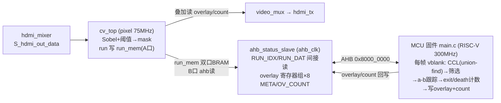

# camera_hdmi_720p — 项目技术细节文档

> 本文档详述 camera_hdmi_720p 工程的每一个技术细节：硬件平台、系统架构、时钟复位、各模块接口与原理、数据通路、模式切换、引脚约束、构建流程、时序分析、已知问题与扩展计划。

---

## 一、项目概述

### 目标
在 PH1P35MDG324（HX1P35A 开发板）上实现 SC520CS MIPI 摄像头 → HDMI 1280×720@60fps 三模式显示工程，通过板载拨码开关 SW4（主选）/SW3（子选）在以下三种 HDMI 输出间切换：

| SW4 | SW3 | KEY2 | 画面 | 数据通路 |
|-----|-----|------|------|----------|
| 0 | × | × | 彩条测试图案 | test_pattern → video_mux → hdmi_tx |
| 1 | 0 | 关 | 边缘提取（Sobel 二值图） | camera → ISP(edge_on=1) → DDR → hdmi_mixer → video_mux → hdmi_tx |
| 1 | 1 | 关 | 彩色摄像头 + OSD | camera → ISP(edge_on=0) → DDR → hdmi_mixer(osd_on=1) → video_mux → hdmi_tx |
| 1 | × | **按一下→开** | 摄像头 + 钢珠绿框（M9） | camera → ISP(edge/osd 关) → DDR → hdmi_mixer → **cv_top(叠加：读 MCU 算的 overlay 画绿框/ID/Count)** → video_mux → hdmi_tx |

### 设计决策
- **整棵搬入厂商 ISP**（demosaic/AWB/edge_detect_96/video_in/video_out/mc_to_user_interface/hdmi_mixer/osd_char_lib/anlogic_logo_rom/uicfgcs520 等），来自两个已验证参考工程 `lab_ex2_edge_SC520`（边缘提取）和 `lab_ex3_osd_SC520`（彩色+OSD）。
- **自研保留件**：`hdmi_timing`（复刻 uivtc 时序 + x/y 输出）、`test_pattern`（彩条）、`video_mux`（帧边界切换）、`status_report`（串口上报）、`reset_ctrl`（复位同步）、`uart_tx`（UART 发送器）。
- **对参考件的两处最小改动**：`isp_top` 加 `I_edge_on` edge bypass mux；`hdmi_mixer` 加 `I_osd_on` 门控。
- **退役件**（移入 `retired/`）：M5 自研 `fb_wr`/`fb_rd`/`ddr_arb`/`fb_ctrl`/`cam_linebuf` 及 M3 自研 `csi2_pkt_rx`/`lane_deint`/`raw10_unpack`/`mipi_stats`/`cam_ctrl`/`i2c_master`。

---

## 二、硬件平台

### FPGA 芯片
- **型号**：Anlogic PH1P35MDG324（PH1P 系列，速度等级 -3）
- **资源**：LUT ~20800 / EBR 108 / DSP 40 / PLL 6 / GCLK 32
- **当前占用（M9，2026-10-15）**：LUT 16377 / EBR 41 / DSP 9 / slice 18072(85%) / PLL 4 / MCU 1；bit `B4C7AF9C`，Setup WNS -1.09ns / Hold +20ps（cv_top/ahb 改动 0 违例，22FEP 全 ISP awb→edge M6 遗留）

### 外设
| 外设 | 接口 | 引脚 |
|------|------|------|
| 50MHz 有源晶振 | 系统时钟 | C4 |
| HDMI-A 接口 | TMDS 4 对 | G16/F17/H14/C17 |
| SC520CS 摄像头模组 | MIPI CSI-2 2-lane + I²C + XCLK + PWDNB | MIPI: V16/U16/V14/U14/V15/U15；I²C: K3/J3；XCLK: L3；PWDNB: L2 |
| USB-JTAG Cable | UART + JTAG | TX: H1 |
| 拨码开关 SW4/SW3 | 模式选择 | D11/E11 |
| AE 按键 ×2 | 自动曝光调整 | N2/J14 |
| LED ×4 | 状态指示 | D10/E10/C6/D6 |
| DDR2 | 帧缓存 | PHY 硬核 pad（IP 内部约束） |

### 开发工具
- **TD（Tang Dynasty）**：6.2.168.116（命令行流程）
- **Python**：3.13（`check_rtl.py` 静态自检 + 行为级仿真）

---

## 三、系统架构

### 数据流总图

```
                         SW4(async)──┐  SW3(async)──┐
                          │           │   │           │
            ┌──3FF─pixel─→│ video_mux select         │
            │              │ (彩条/摄像头)            │
            │             3FF─byte──→ isp_top edge_on │
            │             3FF─pixel─→ hdmi_mixer osd_on
            │
像素域 75MHz:
  hdmi_timing ──vs/hs/de/user/last/x/y──┬→ test_pattern(彩条) ──────────┐
                                         │                              │
  video_out(24bit RGB) ─→ hdmi_mixer ────┤ (OSD 叠加, osd_on 门控) ─────┤
                                         └──────────────────────────────┴→ video_mux(2:1) → hdmi_tx → TMDS

字节域 ~103.5MHz (camera side):
  SC520CS → MIPI D-PHY RX(IP) → csi_unpacket_2lane → raw10_unpacket_2lane → uial2axis
    → isp_top[ demosaic → data128_96 → awb → edge_detect_96(edge_on 门控 bypass) → data_96bit_to_128bit ]
    → video_in(async FIFO,4帧乒乓) → mc_to_user_interface → DDR2 IP → video_out(async FIFO)

100MHz 域: uicfgcs520(I²C 配置) + ae_set(自动曝光) + LED 心跳（M8 起 status_report/uart_tx 退役，串口由 MCU 驱动）
ahb_clk ~150MHz 域（M8 起）: MCU core_clk/2 → ahb_status_slave + ps_wrapper
```

### M9 CV 后处理通路（cv_top ↔ ahb_status_slave ↔ MCU）



cv_top 只留像素级前端（Sobel+阈值+run 写+叠加），CCL/形状筛选/a-b 跟踪/exit 计数全在 MCU 固件。run_mem 双口 BRAM：A 口 pixel 域写、B 口 ahb_clk 域读（MCU 经 RUN_IDX/RUN_DAT 间接寻址）。overlay 8 项 ×64bit 寄存器组在 ahb_slave，MCU 写、cv_top 读叠加。详见 `docs/plan.md`「M9 实施记录」。

**M9 调试流（观测用）**：固件在 `CV=1` 时以 ≈30Hz 输出 `D F=.. RUN=.. NC=.. DET=.. B=<lt100,100_500,gt500> | [.*]area,x0,y0,x1,y1 ..`（run 数 / 连通域数 / 通过筛选数 / 面积分桶 + top 连通域 bbox），解析见 `tools/serial_dbg.py`。**已知瓶颈**：`run_mem` 上限 1024 条 run/帧——环每行约 2 条 run，满屏多球会溢出，导致处理被截断（实测止于 y≈330、钢珠大半没进 CCL）。详见 `README.md`「M9 观测记录」。

### 时钟域划分（4 个异步时钟组）

| 时钟域 | 频率 | 来源 | 用途 |
|--------|------|------|------|
| MIPI byte | ~103.5MHz | D-PHY 恢复（S_csi_rx_clk） | CSI 解包/ISP/video_in 写侧 |
| 系统 | 100MHz | PLL C0 | I²C 配置/UART/LED/SW 同步 |
| 像素 | 75MHz | PLL C4 | hdmi_timing/test_pattern/video_mux/hdmi_mixer/hdmi_tx |
| 串行 | 375MHz | PLL C5 | HDMI TMDS 串行 |
| 摄像头 XCLK | 23.81MHz | PLL C1 | SC520CS 外部时钟 |
| DDR 用户 | 66.67MHz | DDR2 IP 输出 | video_in 读/video_out 写/mc_to_user_interface |

---

## 四、时钟与复位

### PLL 配置（`ip/pll/PLL.xml`，厂商验证配置，本工程未改动）
- 输入：50MHz（C4）
- VCO：1500MHz
- C0 = 100.000MHz（系统逻辑）
- C1 = 23.809524MHz（摄像头 XCLK / I²C 配置域）
- C4 = 75.000MHz（HDMI 像素时钟；720p60 标准 74.25MHz，厂商用 75MHz 偏 +1.01%，已验证可用）
- C5 = 375.000MHz（HDMI TMDS 串行 = 5× 像素）

### 复位方案
| 域 | 模块 | lock 条件 | 说明 |
|----|------|-----------|------|
| 100M | `reset_ctrl u_rst_100m` | PLL lock | 系统逻辑/UART/LED |
| 像素 | `reset_ctrl u_rst_pix` | PLL lock | hdmi_timing/test_pattern/video_mux/hdmi_mixer |
| 24M | `reset_ctrl u_rst_24m` | PLL lock | uicfgcs520/ae_set |
| DDR | `reset_ctrl u_rst_ddr` | PLL lock & DDR 校准完成 | video_in/video_out/mc_to_user_interface |
| 字节域 | 2FF 同步链 | 100M 域复位 → S_csi_rx_clk | CSI 解包/ISP（HS 停摆时该域冻结） |
| HDMI IP | 异步 `~pll_lock` | PLL lock | 跨 75/375MHz 两域，避免复位分发定时违例 |

- `reset_ctrl`（自研）：以 PLL lock 为触发，异步拉低、同步释放（16 拍计数器），保证各域在稳定时钟下开始工作。
- 字节域复位 `S_rst_n_rx`：`S_rx_rst_sync[1]`（100M 域复位 → S_csi_rx_clk 2FF 同步），HS 流量停止时该域逻辑冻结。
- video_in/video_out 用 `S_rst_n`（= PLL lock，异步，跨多域最稳，对齐参考工程）。

---

## 五、模块详解

### 5.1 自研模块

#### `rtl/video/hdmi_timing.v` — HDMI 视频时序发生器
- **角色**：生成 1280×720@60Hz（CEA-861 VIC=4）的 vs/hs/de/user/last/x/y，**逐拍复刻参考 uivtc 时序**（M6 修复画面偏移）。
- **端口**：`clk, rst_n → vs, hs, de, x[11:0], y[11:0], user, last`
- **时序**（与 uivtc 逐拍对齐）：
  - de 延 **2 拍**（= uivtc `vtc_valid_r2`）
  - vs/hs 延 **1 拍**（= uivtc `vtc_vs_r1`/`vtc_hs_r1`）
  - user：uivtc 式（`vs_start` 在 vs 上升沿置位、在 `user_r1` 清零；`user_r1` 在 vs_start 期间首个 de 翻转=单拍脉冲；`user_r2` 延 1 → 与 de(+2) 同拍）
  - last：uivtc 式（de 下降沿 `~de & de_1d` → `last_r2`，与 de(+2) 同拍）
  - x/y：hcnt/vcnt 延 2 拍（与 de 同相对齐，供 test_pattern 组合用）
- **参数**：H_ACTIVE=1280, H_TOTAL=1650, H_SYNC_START=1390, H_SYNC_END=1430, V_ACTIVE=720, V_TOTAL=750, V_SYNC_START=725, V_SYNC_END=730

#### `rtl/video/test_pattern.v` — 彩条测试图案
- **角色**：M1 上板验证用彩条（8 色条 + 4px 白边框 + 灰度渐变 + 移动方块）。
- **端口**：`clk, rst_n, vs, de, x[11:0], y[11:0] → data[23:0], de_o, vs_o`
- **输出 2 级流水**（de_o/data/vs_o = 组合de+3），与 hdmi_mixer 输出(+3)同相 → video_mux 切换时 de/vs/hs **无相位跳变**（M6 修复变量回绕）。

#### `rtl/video/video_mux.v` — 视频源选择
- **角色**：彩条(test_pattern) / 摄像头(hdmi_mixer) 二选一，送 hdmi_tx。
- **端口**：`clk, rst_n, I_sw4, I_pat_data/de/vs, I_cam_data/de/vs → O_data/de/vs, O_sel`
- **帧边界门控**：sel 不每拍跟随 SW4，仅在 **vsync 上升沿**（帧边界，消隐期 de=0）采纳已 3FF 同步的 SW4 → ① 无半帧撕裂 ② 即便残余相位差也落在 de=0 区不可见。

#### `rtl/camera/status_report.v` — 串口状态上报
- **角色**：每 500ms 经 UART 输出一行状态：`CAM ID=<4hex> OK=<0/1> E=<0/1> CFG=<0/1> DDR=<0/1> SW4=<0/1> SW3=<0/1>\r\n`
- **握手修复**：发送 FSM 用 `S_uart_ready`（uart_tx O_ready，组合=IDLE）。uart_tx 捕获字节那拍 ready 仍为 1，若据此推进 S_pc 会同拍重复自增 → 每发 1 字节跳 1 字节。改为"uart 变忙(!ready)后才推进 S_pc"的两段握手。

#### `rtl/common/reset_ctrl.v` — 复位同步器
- PLL lock 异步拉低、本时钟域 16 拍计数同步释放。

#### `rtl/common/uart_tx.v` — UART 发送器
- 115200 8N1，`I_valid` 脉冲接收、单字节发送（起始+8 数据+停止）。

#### `rtl/cv/cv_top.v` — 钢珠亮斑检测 + 白框叠加（M7 Phase A）
- **角色**：串在 hdmi_mixer→video_mux 间，组合直通保相位；`I_cv_on=1` 时叠加白框。1 帧延迟（本帧 vblank 算框→下一帧叠加）。
- **算法（简化 CCL，无 union-find）**：
  - 段1 流式 run 提取（active）：`Y=R/4+G/2+B/4 > BIN_THR` → 1-bit → 连续 1-串 → run{y,xs,xe} 写 `run_mem`(BRAM 同步读)。
  - 段2 CCL（vblank）：逐 run 扫 prev 行缓存（双缓冲 rca，仅相邻行 y==prev+1 才用，隔行清空），取【第一个 x 重叠的 prev label】或新 label，直接累加 `feature[label]`{min/max x/y, area}。无 union-find → 无 `parent[parent[..]]` 嵌套异步读（曾致 TD Map Macro coredump）。过滤 feature→overlay 表。
  - 段3 叠加（下一帧 active）：像素(x,y) 与 overlay 表（≤MAX_BLOBS）并行比较→落边框→白。
- **存储**：`run_mem`=BRAM 同步读；`feature`/`rca`/`ov`=`ram_style="dram"`（分布式 LUTRAM，异步读 1 级地址来自寄存器不嵌套→不崩；写同步单口→无 part-select 写译码爆炸）；`ov` 叠加读常量变址→固定 tap。
- **调参**：`BIN_THR`/`MIN_AREA`/`MAX_AREA`/`MIN_FILL`/`MIN_RATIO`/`EDGE_MG`/`FBOX_W`/`MAX_BLOBS`(16)/`MAX_LABELS`(32)（编译期 parameter）。详见 README「M7 构建记录」。
- **时序**：WNS -1.83ns / 1478 FEP，全在 cv_top 组合路径。CV 关时像素路径仅一 mux（干净，等价 M6）；CV 开时叠加路径有违例（白框可能偶有瑕疵）。
- **CV 开关**：KEY2(A9) 去抖翻转 `r_cv_on`（像素域），同步到 byte/100M；cv_on 强制 `edge_on=0`/`osd_on=0`。

### 5.2 参考件（整棵搬入，来自 lab_ex2_edge + lab_ex3_osd）

#### ISP 子树（`rtl/isp/`）
| 模块 | 文件 | 角色 |
|------|------|------|
| `isp_top` | `isp/isp_top.v` | ISP 顶层：demosaic→data128_96→awb→edge_detect_96(bypass)→data_96bit_to_128bit。**加 `I_edge_on` + 2:1 mux**（edge_on=1 走 edge_detect_96，=0 直通 awb→packer） |
| `demosaic` | `isp/demosaic_4x_2_0/demosaic.v` | Bayer BGGR 双线性去马赛克（40bit RAW10 → 128bit RGB888），2 行缓存 |
| `data128_96` | `isp/data128_96/data128_96.v` | 128bit → 96bit（去 8bit 填充，4×24bit RGB） |
| `awb` | `isp/awb.v` + `isp/signal_delay.v` | 自动白平衡（divider IP + BRAM 延迟） |
| `edge_detect_96` | `isp/edge_detect_96.v` | Sobel 3×3 边缘检测（96bit AXI-S，阈值 80，2 BRAM 行缓存，输出二值 0xFFFFFF/0x000000） |
| `data_96bit_to_128bit` | `isp/data96_128/data96_128.v` | 96bit → 128bit 打包（4 拍 96bit → 3 拍 128bit，S_cnt 相位由 tuser 复位） |
| `csi_unpacket_2lane` | `isp/csi_unpacket_2lane.v` | CSI-2 包解析（DT=0x2B RAW10，2-lane） |
| `raw10_unpacket_2lane` | `isp/raw10_unpacket_2lane.v` | RAW10 解包（5 字节 → 4×10bit 像素） |
| `uial2axis` | `isp/uial2axis.v` | native → AXI-Stream 转换（1280×720，40bit） |

#### 视频通路（`rtl/video/`）
| 模块 | 文件 | 角色 |
|------|------|------|
| `video_in` | `video_in.v` | camera→DDR 写：async FIFO(byte→ddr)，4 帧乒乓（IMAGE_BASE 0/7M/14M/21M），240 字/突发 |
| `video_out` | `video_out.v` | DDR→显示读：async FIFO(ddr→pixel)，行预取(240 字/突发)，128bit→24bit 解包(3 字→16 像素，S_fifo_rd_cnt 每行 de=0 复位) |
| `mc_to_user_interface` | `mc_to_user_interface.v` | 用户口↔DDR IP 桥（155bit FIFO） |
| `hdmi_mixer` | `hdmi_mixer.v` | HDMI 显示混合器：VTC 时序+video_out 数据 → hdmi_tx。**加 `I_osd_on` 门控**（=0 纯视频直通，=1 叠加 OSD）。内置 logo ROM 查找 + 帧计数器文字渲染 + 2 拍视频延迟对齐 |
| `osd_char_lib` | `osd_char_lib.v` | 16×16 字符 ROM（A-Z/0-9/冒号/安/路，39 字形） |
| `anlogic_logo_rom` | `anlogic_logo_rom.v` | 160×160 彩色 logo ROM（左上角，alpha 键控叠加） |

#### 摄像头配置（`rtl/camera/`）
| 模块 | 文件 | 角色 |
|------|------|------|
| `uicfgcs520` | `uicfgcs520.v` | SC520CS I²C 配置（上电时序+165 条寄存器表写入+ID 校验+AE） |
| `uii2c` | `uii2c.v` | I²C 主机（开漏，100kHz） |
| `ae_set` | `ae_set.v` | 自动曝光（按键 N2/J14 增减） |
| `SC520GainTbl` | `SC520GainTbl.v` | AE 增益表 |
| `uics520reg_720p60` | `uics520reg_720p60.v` | SC520CS 720p60 寄存器表（165 条） |
| `uics520regAE` | `uics520regAE.v` | AE 寄存器表 |

### 5.3 IP 核（`ip/`）
| IP | 路径 | 角色 |
|----|------|------|
| PLL | `ip/pll/` | 50→100/23.81/75/375MHz |
| HDMI 1.4b TX | `ip/hdmi/` | RGB→TMDS 编码+PHY（VIC=4, 720p60） |
| MIPI D-PHY RX | `ip/mipi_dphy_rx/` | 2-lane RAW10, 828Mbps/lane, DPHY0 |
| DDR2 控制器 | `ip/ddr2/` | PH1P DDR2 PHY（DDR2-533, 128bit 用户口） |
| divider | `ip/divider/` | AWB 增益除法器 |
| blk_mem_gen_awb_delay_signal | `ip/blk_mem_gen_awb_delay_signal/` | AWB 信号延迟 BRAM |
| w128_d512_fifo | `ip/w128_d512_fifo/` | 128bit×512 双时钟 FIFO（video_in/video_out 跨域） |
| w155_d512_fifo | `ip/w155_d512_fifo/` | 155bit×512 FIFO（mc 桥） |
| blk_mem_gen_demosaic | `rtl/isp/demosaic_4x_2_0/blk_mem_gen_demosaic/` | 去马赛克行缓存 BRAM |
| blk_mem_gen_zhenghe | `rtl/isp/demosaic_4x_2_0/blk_mem_gen_zhenghe/` | 去马赛克整合 BRAM |

---

## 六、数据通路详解

### 6.1 摄像头侧（字节域 ~103.5MHz）
1. **SC520CS** 输出 2-lane MIPI CSI-2 RAW10 @828Mbps/lane。
2. **D-PHY RX**（硬核 IP）恢复字节时钟 `S_csi_rx_clk`（~103.5MHz）+ 16bit HS 数据（2 lane × 1 byte）。
3. **csi_unpacket_2lane**：解析 CSI-2 包头（DI/WC/ECC），输出帧/行同步 + 32bit 负载。
4. **raw10_unpacket_2lane**：5 字节 → 4×10bit 像素（40bit/拍）。
5. **uial2axis**：native→AXI-Stream（tvalid/tdata[39:0]/tuser/tlast）。
6. **isp_top**：
   - demosaic：40bit RAW10 → 128bit RGB888（4×32bit，BGGR 双线性，2 行缓存）
   - data128_96：128→96bit（4×24bit RGB888）
   - awb：96bit RGB → 96bit RGB（白平衡，divider+BRAM 延迟）
   - edge_detect_96（edge_on=1 时启用）：96bit RGB → 96bit 二值边缘（Sobel 3×3，2 BRAM 行缓存）
   - data_96bit_to_128bit：96→128bit 打包（4 拍→3 拍，S_cnt 相位由 tuser 复位）
7. **video_in**：128bit → async FIFO（byte→ddr_clk）→ DDR 写（4 帧乒乓，IMAGE_BASE 0/7M/14M/21M，240 字/突发，+8 地址步进）。

### 6.2 DDR 帧缓存
- **mc_to_user_interface**：用户口（video_in 写 / video_out 读）→ DDR2 IP 应用口（app_cmd/app_en/wdf_*）。
- **DDR2 IP**：DDR2-533（266.7MHz DDR），128bit 用户口，带宽 ~1066MB/s（需求 ~110MB/s，10× 余量）。
- 4 帧乒乓：video_in 写帧 N 到 slot wp，video_out 读 slot rp=wp-2（2 帧延迟，避免读写冲突）。

### 6.3 显示侧（像素域 75MHz）
1. **video_out**：DDR 读 → async FIFO（ddr→pixel）→ 128bit→24bit 解包（3 字→16 像素，S_fifo_rd_cnt 每 16 像素循环、de=0 复位）。行预取（240 字/突发，回扫期内预取下一行）。
2. **hdmi_mixer**：VTC 时序（de/user/last from hdmi_timing）+ video_out 数据 → 延迟 2 拍 + OSD 叠加（osd_on 门控）→ O_hdmi_de/vs/data。
3. **video_mux**：test_pattern（彩条）vs hdmi_mixer（摄像头）二选一（帧边界 vsync 门控切换）→ O_data/de/vs。
4. **hdmi_tx**：RGB→TMDS 编码（VIC=4, 720p60）→ 4 对 TMDS（75MHz 像素 + 375MHz 串行）。

---

## 七、模式切换机制

### SW4/SW3 同步链
- SW4/SW3 各自 3FF 同步到 **pixel/byte/100M 三域**（共 6 条同步链）。
- **video_mux select** = pixel 域 SW4（帧边界门控）。
- **edge_on** = byte 域 `SW4 & ~SW3`（喂 isp_top）。
- **osd_on** = pixel 域 `SW4 & SW3`（喂 hdmi_mixer）。
- 复位默认 SW4=0 → 彩条（安全上电画面）。

### 帧边界切换原理
video_mux 的 sel 仅在 vsync 上升沿（帧边界，消隐期 de=0）采纳 SW4 → 整帧来自同一源（无半帧撕裂）+ 扰动落在 de=0 区不可见。

---

## 八、引脚约束（`constraints/pin.adc`）

| 信号 | 引脚 | IOSTANDARD | 说明 |
|------|------|------------|------|
| I_sys_clk | C4 | LVCMOS33 PULLUP | 50MHz 晶振 |
| O_tmds_ch0/1/2/clk_p | G16/F17/H14/C17 | TMDS33 | HDMI 4 对 |
| O_led[0..3] | D10/E10/C6/D6 | LVCMOS33 DS=8 | LED1-4（高电平点亮） |
| O_cam_24m | L3 | LVCMOS33 DS=8 PULLUP | 摄像头 XCLK 23.81MHz |
| O_cam_rst | L2 | LVCMOS33 DS=8 PULLUP | 摄像头 PWDNB |
| O_cam_scl | K3 | LVCMOS33 DS=8 PULLUP | I²C SCL |
| IO_cam_sda | J3 | LVCMOS33 DS=8 PULLUP | I²C SDA |
| I_button[0/1] | N2/J14 | LVCMOS33 PULLUP | AE 按键 |
| O_uart_tx | H1 | LVCMOS33 DS=8 | UART TX 115200 8N1 |
| I_sw4 | D11 | LVCMOS33 PULLUP | 模式主选（0=彩条,1=摄像头） |
| I_sw3 | E11 | LVCMOS33 PULLUP | 模式子选（0=edge,1=OSD） |

- **MIPI pad**（V16/U16/V14/U14/V15/U15）：D-PHY 硬核 pad，不进 pin.adc。
- **DDR2 pad**：PHY 硬核 pad，由 `ip/ddr2/ddr2/src/adc/ddr2.adc` 约束（经 settings.cfg 的 `IpADCList/IpSDCList` 加载）。

---

## 九、构建流程

### 命令行构建（必须，DDR IP 约束需经 settings.cfg 加载）
1. **syn**：双击 `td_project/camera_hdmi_720p_Runs/syn_1/run.bat`（自愈版：先恢复 settings.cfg 模板再跑流程）。
2. **phy**：双击 `td_project/camera_hdmi_720p_Runs/phy_1/run.bat`（依赖 syn 产出的 gate.db）。
3. td_commands_prompt 调用 `D:/Anlogic/TD_6.2.1_Engineer_6.2.168.116/doc/scripts/DefaultFlow.tcl`（**正斜杠**路径——Tcl `source` 把反斜杠当转义，`\a`=bell 会吃掉；**run.bat 须纯 ASCII**——中文 `rem` 在 GBK cmd 下被误解码致注释行被执行）。
4. **新增源文件后须同步 `.prj`**：TD 命令行 `open_project <prj>.prj` 打开的是 `*_Runs/<run>/<prj>.prj`（工程运行态二进制），**不是 `td_project/<prj>.al`（文本）**。往 `.al` 加源文件后若不重开 GUI，`.prj` 仍旧清单→`HDL-8007 ... is a black box`。用 `python tools/td_run/sync_prj.py <工程目录>` 把 `.al` 同步进各 `.prj`（幂等，只补缺失项）。

### 关键构建文件
| 文件 | 角色 |
|------|------|
| `td_project/camera_hdmi_720p.al` | TD 工程清单（45 RTL + 3 SV + 8 IP，绝对路径） |
| `tools/td_run/syn_1.settings.cfg` | syn 参数（含 `IpADCList/IpSDCList` DDR 约束加载） |
| `tools/td_run/phy_1.settings.cfg` | phy 参数（`parent ../syn_1`，`start_step opt_place`） |
| `constraints/pin.adc` | 引脚约束 |
| `constraints/timing.sdc` | 时序约束（3 组异步时钟） |

### 时序约束（`constraints/timing.sdc`）
- `create_clock` sys_clk_50m(20ns) + mipi_rx_ck_pad(2.415ns)
- `derive_clocks` + PLL 时钟 rename（pll_clk_100m/24m, HDMI_PIXEL/SERIAL_CLK, MIPI_RX_BYTE_CLK）
- `set_clock_groups -asynchronous` 3 组：MIPI / system+HDMI / DDR

### 构建后检查
- `SYN-8534` = 0（DDR IP 约束已加载）
- `HDL-8007` = 0（无多驱动）
- `HDL-5007` in `rtl/` = 0（无常量截断）
- black box = 0
- `flow.status` Setup/Hold WNS + TNS

### check_rtl.py（静态自检）
- `.al` 清单 vs 磁盘文件交叉校验
- 模块端口表解析 + 例化连接校验 + 位宽一致性 + 多驱动检测 + 裸字面量位宽
- 厂商 RTL（isp/ + video_in/out/mc/hdmi_mixer/osd/ cam config）豁免质量检查（仅参与端口解析）；IP 生成件子树（ip/ddr2/ddr2/, ip/pll/, ip/w128/w155_fifo/, ip/divider/, ip/blk_mem_gen_*）全豁免

---

## 十、时序分析

### 当前时序状态（预探针版本，bit md5 B96CCE65）
- **syn**：Setup WNS -2.3ns / Hold +114ps（33 FEP，布线前估计）
- **phy**：Setup WNS -1.7ns / Hold +20ps（9 FEP，最终布线）

### 违例分布（全部在 MIPI_RX_BYTE_CLK 域，ISP）
- **awb→edge 数据路径**：awb 乘法器(`mult4_syn_165`) → edge_detect_96 输出寄存器，Sobel 组合路径 11.9ns vs 9.66ns 周期。
- **复位恢复**：S_rx_rst_sync → ISP 各寄存器 `.asr`（高扇出 recovery）。
- 参考工程（TD 6.1）同款 ISP 在 112.5MHz 下 +1.725ns 通过；本工程 TD 6.2 推断 AWB 除法器/乘法器更慢致违例。

### 影响
- **彩条模式**：不经过 ISP，时序干净（M1 验证 0 违例）。
- **OSD 彩色模式**：edge_detect_96 输出被 bypass mux 丢弃（edge_on=0），awb→DDR 数据路径时序干净。OSD 显示正常。
- **边缘模式**：edge_detect_96 输出被使用，awb→edge 路径有 -1.7ns 违例，可能产生边缘画面瑕疵。

---

## 十一、已知问题

### 1. OSD 模式左侧 ~5px 画面重复
- **现象**：OSD（摄像头）模式，屏幕左侧 ~5px（1 个 128bit 字）有画面重复。
- **根因排查**：uivtc 时序复刻后仍存在 → 与 timing 无关，在 video_in/DDR/video_out 数据通路的 1 字级偏移。静态分析（打包 S_cnt、写地址、读地址、解包 case、FIFO L=1 同步 BRAM）均正确、与参考一致。未定位到确切根因。
- **影响**：对视觉显示轻微（左缘窄条）；对钢珠反射 CV 检测影响微小（反射在主体区域）。
- **待续**：可加 on-board 探针（video_out 输出字索引标记图案）定位是解包侧还是写侧。

### 2. 边缘模式时序 -1.7ns
- awb→edge Sobel 路径在 103.5MHz 下 -1.7ns（TD 6.2 推断差异）。
- 仅影响 edge 模式画面（可能瑕疵）；OSD/彩条不受影响。
- 可选优化：pipeline 寄存器 / reset false_path / max_fanout（M7）。

### 3. 串口 ID=EE4B / E=1
- 参考件 `uicfgcs520` 只读上电初始 ID（不回读配置后值 9E4B），E 标志为非关键/粘滞位。
- 传感器配置已生效（OSD 彩色画面正常），属上报语义差异非功能故障。

---

## 十二、CV + 形态学扩展计划（钢珠反射识别）

### 目标
在摄像头画面上识别钢珠的反光（亮斑），用于工业检测。

### 影响评估
- 当前 ~5px 左侧重复对 CV 影响微小（反射在主体区域）。
- 资源有余量（LUT 47%, EBR 36%, DSP 22.5%）。
- 像素域接入时序安全（75MHz 干净）；字节域接入会恶化 ISP 违例。

### 拟定架构（像素域接入，推荐）
- **接入点**：video_out → [CV 模块] → hdmi_mixer（或直接 → video_mux）
- **流水线**：
  1. 亮度阈值（Y = R/4+G/2+B/4 > THRESHOLD → 二值掩码）
  2. 3×3 开运算（腐蚀→膨胀，去孤立点噪声，2 行缓存）
  3. 叠加高亮（掩码=1 处染色/画框，叠加在 HDMI 输出上）
- **新模式或叠加**：可作第 4 个 SW 状态（SW4=1,SW3=×+扩展），或始终叠加在 OSD 模式上。
- **复用**：edge_detect_96 的行缓存 + 3×3 窗口设计可作形态学参考。

---

## 十三、文件清单

### RTL（45 个 Verilog + 3 个 SystemVerilog）
- `rtl/top/design_top_wrapper.v` — 板级顶层
- `rtl/common/` — reset_ctrl, uart_tx
- `rtl/video/` — hdmi_timing, test_pattern, video_mux, video_in, video_out, mc_to_user_interface, hdmi_mixer, osd_char_lib, anlogic_logo_rom
- `rtl/camera/` — status_report, uicfgcs520, uii2c, ae_set, SC520GainTbl, uics520reg_720p60, uics520regAE
- `rtl/isp/` — isp_top, edge_detect_96, csi_unpacket_2lane, raw10_unpacket_2lane, uial2axis, awb, signal_delay, demosaic_4x_2_0/*, data128_96/*, data96_128/*
- `ip/mipi_dphy_rx/` — *.sv, *.enc.v, *.enc.sv（D-PHY RX 硬核配套件）

### IP（8 个）
- PLL, HDMI 1.4b TX, MIPI D-PHY RX, DDR2, divider, blk_mem_gen_awb_delay_signal, w128_d512_fifo, w155_d512_fifo, blk_mem_gen_demosaic, blk_mem_gen_zhenghe

### 约束
- `constraints/pin.adc` — 引脚
- `constraints/timing.sdc` — 时序（3 组异步时钟）

### 工具
- `tools/check_rtl.py` — 静态自检
- `tools/td_run/` — 命令行构建模板 + 自愈 run.bat
- `tools/sim/` — 行为级仿真（Python）

### 退役（`retired/`）
- M5 自研 fb_wr/fb_rd/ddr_arb/fb_ctrl/cam_linebuf
- M3 自研 csi2_pkt_rx/lane_deint/raw10_unpack/mipi_stats
- M2 自研 cam_ctrl/i2c_master
- ip/sc520reg/uics520reg_720p60.v（被 rtl/camera/ 同名件取代）

---

## 十四、版本历史

| 版本 | 内容 | bit md5 |
|------|------|---------|
| M1-M5 | 自研 MIPI/DDR/灰度（半净室） | (历史) |
| `6429287` | M6 三模式重构 + status_report 握手修复 | A1CF247 |
| `6b262c1` | test_pattern 2 级 + video_mux vsync 门控（修变量回绕）+ hdmi_timing 复刻 uivtc（修静态偏移）+ 回滚探针 + 本技术文档 | B96CCE65 |
