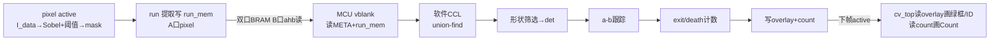

# camera_hdmi_720p 实施计划

目标：在 `work/camera_hdmi_720p/` 下（半净室）实现 SC500CS/SC520CS MIPI 摄像头 → HDMI 1280×720@60fps 的完整显示链路，
结构清晰、可继续演进（算法/按键/OSD），不复制参考工程胶水代码。

## 一、调研结论（据厂商资料）

### 链路与器件

- 芯片：PH1P35MDG324（安路 PH1P 系列）；板卡：HX1P35A；工具：TD 6.2.1。
- 摄像头：SC500CS / SC520CS，MIPI CSI-2 2-lane RAW10，HD 模式 1280×720@60（内部 2×2 binning + crop）。
- 板级：50MHz 有源晶振（C4）→ PLL；HDMI-A 直连 FPGA（TMDS33）；MIPI 42P FPC 经 TXS0104E 电平转换；
  DDR2（IP 参数：tCK=1876ps→533MHz、16bit、Row13/Col10/BA2）。

### 传感器（SC520CS）

- I²C：上电默认 7 位地址 **0x36**（SID 低）；备用 0x10。
- Sensor ID 寄存器 0x3107/0x3108：上电未加载 setting = `ee4b`，初始化完成后 = `9e4b`（用于 M2 验证）。
- 上电时序：T4 ≥ 1ms（XSHUTDN 释放后）、T5 ≥ 5ms（再发 I²C/XCLK 数据）。
- 关键寄存器：软复位 0x0103[0]、睡眠 0x0100[0]、lane 数 0x3018、RAW10 0x3031、
  输出窗口 {0x3208,09}/{0x320a,0b}/{0x3210–13}、VTS {0x320e,0x320f}、曝光/增益 0x3e00~0x3e09、Group hold 0x3812。
- 传感器自带测试图案 0x4501 可辅助验证"传感器→MIPI→ISP"链路。

### 厂商 SC520 720P 参考（仅作配置事实参考）

- MIPI RX：`DPHY0`、2-lane、EQ=3dB、VGA=8dB、delay=0、invert=0；寄存器表注释"828Mbps/lane"。
- MIPI 时钟约束：`create_clock` 于 `IO_rx_clk_pad_p`，周期 2.415ns（=414MHz 时钟 → 828Mbps DDR）。
- 约束要点：`sys_clk_50m` 20ns + `derive_clocks` + PLL 时钟重命名 +（MIPI/DDR/系统）异步时钟组。
- DPHY 输出字节时钟：`o_fabric_div4_8_clk`。

## 二、架构

```
S_50m 域:  I_sys_clk → PLL(复用) → 100M / 23.809524M / 75M / 375M
─────────────── 像素域 (75MHz) ───────────────
hdmi_timing(自研) → test_pattern(自研) ─┬→ hdmi_tx(复用) → hdmi_phy(复用) → TMDS 4 对
                                        └→ (M4 起) 帧缓存读出 → ISP(自研)
─────────────── M3 起 ───────────────
SC520CS → MIPI RX(IP) → csi2_unpack/MIPI 统计(自研) → raw10_unpack(自研)
        → (M4)行缓存/(M5)DDR2 帧缓存(自研控制) → isp(自研) → 像素域
camera 控制(自研 M2): 上电时序 + I²C 主机 + 寄存器表加载 + 状态机
```

## 三、里程碑与验收

| # | 内容 | 上板验收 |
|---|---|---|
| M1 | 工程骨架 + HDMI 测试图案 | ✅ 彩条+移动方块稳定显示；LED 心跳；时序 0 违例 |
| M2 | 摄像头控制（上电/I²C/寄存器表） | ✅ 串口 `ID=EE4B ADR=36 W=A5 P=9E4B OK=1 E=0`（500ms 循环）；LED4=ID 校验通过 |
| M3 | MIPI 接收 + CSI/RAW10 解包 + 帧统计 | ✅ **上板验收通过**（2026-09-27 09:59）：串口 `MIPI HS=1 F=…(60fps) L=0720 W=01280 G=0320 ER=00 HW=2B06403B PL=0000 HC=0`；首轮发现 D-PHY 字节配对问题（原始流配对为 `(b0,b2),(b1,b3)…`），加 `lane_deint.v` 重排后通过 |
| M4 | 灰度直通（行缓存） | ✅ **上板验收通过**（2026-09-27）：实时灰度画面、感光正常；串口 `HS=1 … RX=1`（帧率 ≈59.6fps）；画面证据 `work/test/M4_00/` |
| M5 | DDR2 帧缓存 | 🟡 计划已定（见下「M5 实施要点」），IP 已入库 `ip/ddr2/`，待实施 |
| M6 | 三模式重构（彩条/边缘/彩色+OSD，SW4/SW3） | ✅ 上板通过（2026-09-28~29）；bit `B96CCE65` |
| M7 | 钢珠检测（CV，Phase A 检测+框选） | ✅ 编码完成；bit `6D1CC08E`；后演进到 Phase B（Sobel+跟踪+计数） |
| M8 | MCU 接管串口状态上报（B1–B8） | ✅ 上板通过（2026-10-12）；`status_report.v`/`uart_tx.v` 退役 |
| M9 | CV 后处理转 MCU（CCL/跟踪/exit 计数） | 🔨 编码+构建+固件编译+上板通过，参数待调（2026-10-15）；bit `B4C7AF9C`，ELF `68148597`；详见下「M9 实施记录」 |

### M2 实施要点（已完成编码 + 仿真验证）

- I²C 主机自研（开漏、100kHz、16 位子地址、读用 Sr+NACK+STOP）；从机地址先试 7'h36，整笔 NAK 再试 7'h10 ⇒ 不依赖模组 SID 跳线。
- 寄存器表用原厂 165 条（`ip/sc520reg/`，数据件），逐条写入后复读 ID 校验：`EE4B`(未加载) → `9E4B`(已加载)。
- 调试通道：板上 UART（USB-JTAG Cable 的 Type-C 双通道之一，115200 8N1；**H1=TXD / J1=RXD**）输出 `CAM ID=.. ADR=.. W=.. P=.. OK=.. E=..`，错误码 E 区分"无应答/写表 NAK/ID 不符"。
- 上板前验证：`tools/check_rtl.py`（静态）+ `tools/sim/i2c_sim.py`（协议）+ `tools/sim/cam_sim.py`（流程，含真实 ROM 与 SC520 模型）。

### M3 实施要点（2026-09-27）

- **复用**：`ip/mipi_dphy_rx/`（D-PHY 硬核 IP + 官方配套件，与厂商原件逐字节一致）；参数取 SC520 720P lab 原值
  （`HS_EQUALIZER="3dB"` 对应 828Mbps/lane）。硬核 pad 是器件专用脚，**不进 `pin.adc`**。
- **自研**：`rtl/mipi/lane_deint.v`（拍对重排）、`csi2_pkt_rx.v`（包解析）、`raw10_unpack.v`（解包）、
  `mipi_stats.v`（统计 + 跨域握手）、`rtl/camera/status_report.v`（两行串口上报）。
- **字节序（首轮上板踩到的坑）**：硬核每拍给出 lane0/lane1 各 1 字节，原始流配对为 `(b0,b2),(b1,b3),…`
  （实测 `HW=2B40063B`）；必须还原为 `A高,B高,A低,B低` 才是标准 CSI-2 次序，否则 WC 会被读成 0x4006
  这种荒谬值、负载永远消费不完。`lane_deint.v` 就是干这个的（包首重置配对相位）。
- **时钟**：`timing.sdc` 增加 `mipi_rx_ck_pad`(2.415ns) → `MIPI_RX_BYTE_CLK`（IP 内部 ÷4 字节时钟）+
  两域 `set_clock_groups -asynchronous`；跨域只有统计快照，用 req/ack 双相握手。
- **验证**：`tools/check_rtl.py` 0 错 0 警；`tools/sim/mipi_sim.py` 一帧 921600 像素逐点一致 + 错误注入 5 场景
  + 包头契约回归（`WC=1600` 原始流必须 = `2B40063B`）通过；仿真激励按硬件真实拍流格式构造。
- **风险**：见 README「M3 待上板确认的假设」（包间 valid 拉低 / 2-lane WC=1600 / 720 行 1280 列），
  失败均有对应 `ER` 错误位可定位。

### M4 实施要点与预期效果（灰度直通，行缓存版）

**预期效果（上板后屏幕上应该看到什么）**

1. **屏上出现摄像头实时画面，替换掉 M1 以来的彩条测试图案**：镜头对着什么，屏幕显示什么，
   移动镜头时画面跟手（实时 60fps，无卡顿）。
2. **是灰度（黑白）画面**：亮度 = RAW10 高 8 位（`>>2`）送 R=G=B。**彩色要等到 M6。**
3. **画面会看到细密的棋盘格纹理**（Bayer 阵列的 RGGB 相位）—— 这是**预期现象不是故障**，
   去马赛克在 M6。近看有轻微"网格感"属正常。
4. **亮度偏暗、对比度偏低**（黑电平未扣、无 gamma）—— 加一级常数黑电平扣除 + 简单拉伸后
   画面应当"正常可看"，但不追求好看（ISP 在 M6）。
5. **允许轻微撕裂/横向抖动**（画面里偶尔一条水平错位）：因为行缓存版没有帧缓存，
   摄像头与 HDMI 各自自由跑，行相位会缓慢漂移 → **无撕裂是 M5（DDR 帧缓存）的验收项**，M4 不要求。
6. **串口两行保持 M3 的达标状态不变**（`CAM OK=1`、`MIPI L=0720 W=01280 G=0320 ER=00`），
   屏幕内容不影响 MIPI 链路；LED 行为保持 M2。
7. **按键/开关（若做）：可在"摄像头画面 ↔ 彩条测试图案"之间切换** —— 测试图案是已知正确的基准，
   便于 A/B 判断问题出在采集侧还是显示侧。

**验收标准（可判定）**

- 屏幕出现实时灰度画面，镜头遮挡/移动有明显反应；
- 串口 MIPI 行仍为 `L=0720 W=01280 G=0320 ER=00`（M3 不退化）；
- 允许撕裂与偏暗；不允许全黑/全白/纯噪声/行错位整体错行。

**实现要点（自研）**

- 新增 `rtl/video/cam_linebuf.v`：**双行缓存 ping-pong**
  - 写侧（字节时钟域，103.5MHz 突发写入）：把 `raw10_unpack` 输出的像素按行内序号写入 BRAM，
    行首清零写地址；行突发约 7.8µs，远小于 23.1µs 行周期，ping-pong 有足够余量。
  - 读侧（HDMI 像素域 75MHz）：由 `hdmi_timing` 的 `de/x/y` 驱动，按 `x` 取当前行像素，
    输出 `{gray,gray,gray}` + `de_o`。跨时钟用双口 BRAM（TD 可推断）＋ 2 级同步器。
  - 行缓冲切换：写侧行首翻转 bank，经 2 级同步 + 握手指针交给读侧；读侧读取"上一行"，
    避免读到正在写的行（漂移时宁可丢一行，不撕裂整幅）。
- 新增 `rtl/video/video_mux.v`：把 `test_pattern` 与 `cam_linebuf` 的输出按开关二选一，
  接口与 `test_pattern` 完全一致（`data/de_o/vs_o`），顶层例化位置不变。
- 保留 M1/M2/M3 的一切调试通道（串口、LED、HDMI 测试图案），M4 失败时可直接切回图案定位。
- 仿真：新增 `tools/sim/linebuf_sim.py`（写侧突发 vs 读侧 75MHz 取数、bank 切换、行首对齐、
  漂移丢行）——当时本机无 iverilog，用逐拍 Python 行为级模型（现 iverilog 已装，见 README「工具」段）。

### M5 实施要点与预期效果（DDR2 帧缓存）

**目标**：用板载 DDR2 做整帧帧缓存，替代 M4 的行缓存通路；相机与显示彻底解耦 → 画面稳定、无滚动、无撕裂。

**预期效果（上板后屏幕上应该看到什么）**

1. **画面稳定、不再滚动**：SW4 拨上（=1）为摄像头灰度画面 —— M4 的「自上而下缓慢滚动」消失
   （显示改为逐帧从帧首扫、读"最近写完的完整帧"，不再"跟随最新行"）。
2. **无撕裂**：不会出现上下半屏错位 —— 显示永远读一帧写完的整帧；写侧切换缓冲只影响下一帧。
3. 相机 59.6fps 与显示 60Hz 的 0.4Hz 差表现为**极轻微周期性重帧（judder）**，属预期，不算缺陷。
4. 亮度/条纹表现与 M4 相同（Bayer 网格仍在，M6 消；偏暗属预期）。
5. SW4 拨下（=0）：测试图案照旧（A/B 基准）。
6. 串口：原两行不退化；**新增第三行 DDR 统计**（500ms 一次）：
   `DDR RDY=1 WR=<写帧计数> RD=<读切换计数> OV=<写冲突丢帧> UN=<行下溢>`

**验收标准（可判定）**

- 屏幕：连续观察 ≥30s，画面稳定无滚动、无撕裂（允许 judder / Bayer 网格 / 偏暗）；
- 串口：第三行 `RDY=1`、`WR` 持续增长（≈59.6/s）、`OV=0`、`UN=0`；MIPI 行与 M3/M4 基线一致（不退化）；
- SW4=0 测试图案正确（M1 基线不退化）。

**架构（自研部分）**

```
相机侧（字节域 103.5MHz）              显示侧（像素域 75MHz）
raw10_unpack → 灰度化((px-64)>>2) → 异步FIFO（8bit 像素 + 行标志）
                                      ↓
               dhi_clk 域（IP 输出的用户时钟）
  fb_wr   ：16 像素打包成 1×128bit 字，逐行写（每行 80 字）
  fb_rd   ：行预取（回扫期内取下一行 80 字）→ 双口行缓存（2 行乒乓）→ 像素域读出
  ddr_arb ：单 paxi 口仲裁（读优先，写次之；按整突发轮转）
  帧同步  ：写侧行计数到 720 → 帧完成标志（2 级同步到读侧）；
            读侧在 vsync 时刻若存在"更新的完整帧"→ 切帧基址，否则重复读当前帧
```

**帧缓冲布局**（**地址单位 = 2 字节**；依据 IPUG035 表 3-5 与 lab 实测「每 128bit 字 +8」）：一帧 = 921600B =
**460800 单位（0x70800）**；三缓冲抗冲突：`FRAME0=0x00000 / FRAME1=0x80000 / FRAME2=0x100000`
（各隔 1MB 字节；帧仅占 0.879MB）；行 y、字 k 的地址 = `FRAME + y*640 + k*8`。
写侧若目标缓冲仍被读侧占用 → 换缓冲并计 `OV`（宁可丢帧不撕裂）。

**复用与自研边界（半净室）**

- **复用**（IP 生成件，已入库 `ip/ddr2/`，逐字节保真）：厂商 SC520 lab 的 `ph1p35_ddr/` 整棵
  （IP `ddr2/` + 引脚适配件 `ph1p35_324_ddr_wrapper.v` + 自带 `.adc/.sdc`）。
- **自研**：`rtl/video/fb_wr.v`、`fb_rd.v`、`ddr_arb.v`（打包/预取/行缓存/仲裁/帧同步/统计）、
  `.al` 增补、`timing.sdc` 增补（dhi_clk 域与各域异步声明）、`tools/sim/fb_sim.py`、status_report 第三行。
- **仅作接口事实参考（不抄实现）**：厂商 lab 的接线法（ref_clk=50MHz、用户逻辑跑 dhi_clk）、
  IP 手册 IPUG035 的 paxi 协议判读。
- M4 的 `cam_linebuf.v` 从视频通路退役（文件保留作参考，不再例化）。

**上板顺序（两步走，降低定位成本）**

1. **①空载校准版**：只例化 DDR IP（无视频通路），串口第三行只报 `RDY`。验证 IP 接线/时钟/引脚/校准 OK；
   若失败，问题域收窄在 IP 接线，不必排查整条视频链。
2. **②完整帧缓存版**：接上写/读/仲裁与 SW4 切换，按上面验收标准判定。

*进度：①空载校准版 2026-09-27 **重建通过**（**新** bit：final SWNS +0.101ns / HWNS +0.020ns、TNS/HTNS 0；`ip/ddr2/` 已入库、`.al` 增补 wrapper+IP、顶层例化、串口第三行 `DDR RDY/ARDY/WRDY`、`timing.sdc` 增 DDR 时钟组）。构建首败根因（IP 约束未加载 → `SYN-8534`）与固化方案见 README「M5 构建记录」与 `tools/td_run/` —— **IP 约束必须经命令行流程加载，勿用 GUI Run 启动这组 run**。首版上板暴露串口回归（`status_report` 里 `7'd144/7'd145` 位宽截断 → MIPI/DDR 两行全 0x00），已修（提交 `b9b3695`）并重建。**①已上板验收通过（2026-09-27：`DDR RDY=1` 稳定，证据 `work/test/M5_00/`）**；②实施计划已细化（见下）。*

### M5-② 实施计划（细化，2026-09-27 核对后定稿）

**接口事实（从 IPUG035 + 厂商 lab + 构建报告三方核对，实现时逐条对照）**

| 项 | 结论 | 依据 |
|---|---|---|
| 用户时钟 | `dhi_clk`（IP `usr_clk`）= **66.667MHz**，TD 自动推导并计时（15ns 预算） | phy 报告 `clk2: 66.667`、area `usr_clk 66MHz` |
| DDR 实际速率 | **266.7MHz 即 DDR2-533（半速）**：板给 50MHz，IP 参数按 100MHz 参考生成（三 lab 同款）→ 峰值带宽 **1066MB/s**（需求≈110MB/s，≈10× 余量） | `.params_ddr2.txt` + 报告实测 |
| 地址单位 | **2 字节**：`axi_byte_addr={paxi_addr,1'b0}`（Data=128）；128bit 字=+8；行=640；帧=460800（0x70800）单位 | IPUG035 表 3-5；lab `+8` 步进实测 |
| 命令颗粒度 | **单拍**：一次 `en`（cmd[0]：0=写/1=读）= 1×128bit 字；写数据可滞后地址 ≤2 拍；读响应恰 1 拍、延迟 ≥40 拍 | IPUG035 3.7.3 + lab 注释 |
| 就绪门控 | 读写统一等 `O_mc_app_rdy & O_mc_app_wdf_rdy` 同拍接受（OR 语义照厂商 lab 用法；写实判=awready） | `mc_to_user_interface.v`、`video_in/out.v` |
| 掩码/杂项 | `wdf_mask=0`=全写（paxi 掩码高=屏蔽该字节）；`O_mc_app_rd_data_end` 适配件未驱动、勿用 | IPUG035 + lab |
| 参考手册 | `D:\Anlogic\TD_6.2.1_Engineer_6.2.168.116\doc\IPUG\IPUG035_PH1A_DDR_IP_Guide.pdf` | — |

**模块划分（自研，rtl/video/）**

1. `fb_wr.v`：字节域入队段沿用 M4 `cam_linebuf` v2 的异步 FIFO（自研复用；条目扩为
   `{fs,fe,line_start,line_end,dvalid,px[39:0]}`，45bit×8，纯触发器）；usr_clk 侧灰度化 `(px-64)>>2`
   → 4 组拼 128bit → 行内 k=0..79 逐字发写请求 → 帧完成（FS 后第 720 个行尾）上报 fb_ctrl；统计 `WR/OV/ER`。
2. `fb_rd.v`：usr_clk 侧行预取（显示行 y 开始即预取 y+1 的 80 字；y=719 不预取；vsync 预取 y=0）；
   行缓存 = **160×128bit 双时钟 BRAM**（bank=y&1，每 bank 80 字）；像素侧读口：字索引 `x[10:4]`、
   字内字节 `x[3:0]`，2 级流水、`data/de/vs` 同拍（沿用 M4 约定）；统计 `RD/UN`。
3. `ddr_arb.v`：两路请求 → 单 mc_app 口；**读优先**；`rdy&wdf_rdy` 同拍接受；读响应按序回送；
   watchdog（>256 拍无 rvalid → 计错并复位预取行为）。`ARDY` 偶低（M5-① 实测）= 正常等待。
4. `fb_ctrl.v`：三缓冲状态机（FREE/WRITING/READY/DISPLAY）+ 基址查表；写侧帧完成 → READY；
   显示 vsync（pixel 域 → usr_clk 翻转脉冲）→ 换 DISPLAY；无新帧 → 重复旧帧（judder，属预期）。
   跨域只用翻转脉冲，usr_clk 侧自维护行计数（无多比特直接跨域）。
5. 顶层：`cam_linebuf` 退役（文件保留不例化）；新增 usr_clk 域 `reset_ctrl`（`ddrphy_rdy=1` 后才释放）；
   `status_report` 第三行扩为 `DDR RDY=? WR=xxxx RD=xxxx OV=x UN=x ER=x`（req/ack 快照，同
   mipi_stats 结构；字节表常量位宽 ≥8 位，过 check_rtl）。

**实施顺序**：RTL → `tools/sim/fb_sim.py`（Python 行为级：打包/预取/仲裁/三缓冲/端到端比对，
注入 rdy 抖动与读延迟）→ 命令行重建（syn→phy，检查项同 ①，另看 usr_clk 组 slack）→ 上板
（先 SW4=0 基准不退化，再 SW4=1 验收）→ 证据入库 + README/技能库同步。

**② 专项风险**：① 读接受语义（`app_rdy` 为 OR）—— 按厂商 lab 同款门控 + watchdog 兜底，
上板 UN=0 即证；② 读延迟 ≥40 拍 —— 预取提前整行（≈22µs）余量巨大；③ 换帧后立读新缓冲的
写完成性 —— vsync 换帧 + blanking ≥0.5ms，写侧早已排空；④ 行缓存 BRAM 推断（128bit 宽、双时钟）
—— 构建后核对 area/EBR 报告，异常则降位宽拆份。

**验收（沿用上节标准）**：≥30s 无滚动无撕裂；串口 `WR≈59.6/s 递增、RD 递增、OV=0 UN=0 ER=0`；
MIPI 行与 SW4=0 彩条均不退化。

**② 仿真结果（2026-09-27，4 用例全通过，日志 `work/test/M5_01/fb_sim_stdout.log`）**

`tools/sim/fb_sim.py` 逐拍复刻 fb_wr/fb_rd/ddr_arb/fb_ctrl + DDR 模型（读延迟/应用口停顿/读挂起注入，
空闲期时间跳跃加速，全程 ~23s）。用例：①正常帧流 3 帧逐点比对 864k 点；②读延迟 120 拍 + 应用口间歇忙；
③读挂起（6000 拍不复位）看门狗；④坏帧（大量丢组）不上屏。结果：**像素不一致 0、条目丢弃 0、
WR/RD/OV/UN/ER 全部符合预期**。

仿真在建板前抓到并修复 **2 个 RTL 真缺陷**（均会直接显现在画面上）：

1. `ddr_arb`：接受命令后同一拍就回 IDLE 重新采样请求，而主机（fb_rd/fb_wr）要下一拍才看到 gnt 并
   更新计数 → **同一地址被重复采样**（观测：行数据整体错位一个字、行末字缺失）。修复：接受后插入
   1 拍冷却 `S_cd`，`ST_IDLE` 先消耗冷却再采样（读写两条路径同处理）。
2. `fb_ctrl`：`O_rd_base` 原为纯寄存器，vs 换槽要下一拍才对 `fb_rd` 可见，而预取启动恰在 vs 次拍 →
   **每个新显示帧第 0 行读的是旧槽**（屏幕顶部一行残影，60fps 下持续可见）。修复：`O_rd_base` 改为
   组合输出（vs 当拍预览 `S_rdy_idx` 基址），与写侧 `O_wr_base` 的既有做法对齐；内部寄存器改名
   `S_rd_base`。

另修 3 处**仿真侧**（非 RTL）缺陷：拍首快照语义、空闲跳跃漏掉挂起事件/预取 want、写保护误用
自增后指针导致每行末字丢失。

**② 构建结果（2026-09-27 13:35–13:44，命令行 syn→phy 一次通过）**

- syn：opt_rtl 20s + opt_gate 21s，**Setup WNS +860ps / Hold +114ps，0 违例**；
- phy：place 45s + route 26s + fix_hold 2s + bitgen，**final Setup WNS +1376ps / Hold +20ps，TNS/HTNS 0，0 违例**；
- bit：`phy_1/camera_hdmi_720p.bit`（1,789,539 B）md5 `05dbd1a71a1b190c4bcce470971b5782`；
- 面积：LUT 7601（slice 26.7%）、EBR 21/108（19.4%，**fb_wr 8 + fb_rd 8 = 行缓存 BRAM 推断成功**）、DSP 0；
- IP 约束 45 ippin + 16 ipinst（`u_ddrphy_byte LOCATION=X0Y70Z0`）全进场；`SYN-8534` 0；自身 rtl/ 的
  `HDL-5007`/`HDL-7225` 均 0。
- 构建期另拦下 2 个问题：① TD 命令行流程读的是 run 目录 `.prj`（不是 `.al`）→ 新增
  `tools/td_run/sync_prj.py`；② `fb_wr.v` 的 `S_dtgl0/1` 多驱动（HDL-8007）→ 修 + `check_rtl.py`
  新增多驱动检查。详见 `work/test/M5_01/NOTES.md`。

**③ 上板诊断（2026-09-27 下午）：横向错位 ≈208px（13 字）**

- **现象**：内容恒定环绕错位（右侧 ~1/6 折到最左，分界线笔直稳定）；纵向细条纹 = Bayer 网格（M6 消）；
  “16px 周期竖条纹”经拍摄端伪影证伪。串口/MIPI 全健康（WR≈59.2/s、OV=0、ER=0）。
- **诊断 v1（白框探针，bit md5 `bd59ed4a…`）**：白框两条竖边合并出现在 ≈208~215px（宽 ~16 屏幕像素）、
  顶/底横线贴边横贯全幅、屏幕最左无白线 ⇒ **白框（打包引擎自身坐标）被整体挪移 ⇒ 错位在「打包之后」**。
  详见 `work/test/M5_03/NOTES.md`（含照片与测量）。
- **全链路静态复核**：打包字序/行缓冲/排空/仲裁/回填/显示读出/时序生成/顶层接线/三缓冲基址 + `fb_sim.py`
  全文逐字对照与重跑（104 万检查点零不一致）——**零发现**；源码中不存在 ~13 字的任何偏置。
- **诊断 v2（三标记同框，bit md5 `426c57318ae54c68652adc3b272a800c`）**：W2 显示读出侧坐标白条 +
  W3 回填侧 0x88 隔行灰条 + W4 排空侧 0x55 隔行灰条（W1 白框保留），一次构建切开
  「打包→排空→DDR→回填→显示」五段。判读表见 `work/test/M5_04/NOTES.md`。
- **诊断 v2 判读（2026-09-27，照片在 `work/test/M5_05/`，196 为唯一全屏可标定视图）**：W2 白条在原位
  （x≈0..64）⇒ 显示读出诚实；W3/W4 灰柱逐行交替落**屏幕第 0 字**（x≈1..15）⇒ 回填/排空索引诚实；
  W1 白框两竖边并排出现在 **x≈200..215**（左右顺序交错 = mod 80 回绕特征）⇒ **打包第 m 字 → 屏幕
  第 m+13 字（≈208px）**；屏幕最右列实测为内容（非白）⇒ 排除输入相位解释。**+13 字旋转位于
  「打包写入之后、显示读出之前」中段**；同日全链逐字复核（含 FIFO 出队段、行/帧地址公式）零偏置 ⇒ 转硬件定点。
- **诊断 v3（W5 写索引探针）**：`fb_wr` 新增参数 `DIAG_W5`——打包写索引 5 的字替换为全白 16px 竖带，
  一次构建三选一定点：**x≈80..95 ⇒ 打包写入级；x≈288..303 ⇒ 排空读出级；x≈1152..1167 ⇒ 回填读出级**。
- phy 余量注记：final WNS +112ps（0 违例），worst path = `u_rst_100m → sys_rst_n`（fanout 512 复位网）
  recovery 检查，属布局抽签的合法边缘余量、与视频链无关；**遗留优化项：复位树复制 / max_fanout 约束**。

**风险与对策**

1. DDR IP 首用、校准失败（`RDY` 不置位）：先跑①步隔离；备选 100MHz 差分钟振作 ref_clk。
2. paxi 协议细节误读：①步只用到最小功能；协议判读以 IPUG035 与 IP 端口注释为准，仿真先行。
3. 时序：新增 dhi_clk 域 + IP 自带约束；缺的跨域声明按 M4 经验用 `set_clock_groups` 补齐，编译后读 clock summary 核对。
4. `.al` 增补（TD 覆盖清单的老坑）：改动前确认 TD 已完全退出；只加两条（wrapper .v + ddr2.xml）。
5. **构建流程（M5 已解决，留档）**：DDR2 IP 约束只能经 run `settings.cfg` 的 `IpADCList/IpSDCList` 由命令行流程加载；
   GUI Run 不读该文件且会 reset/重写它 → 报 `SYN-8534`。已固化 `tools/td_run/`（模板 + 自愈 run.bat），
   今后重建一律双击 `*_Runs/{syn_1,phy_1}/run.bat`。

## 三·补、M9 实施记录（CV 后处理转 MCU，2026-10-15）

**背景**：M7 cv_top 把 CCL/形状筛选/a-b 跟踪/计数 FSM 全做在硬件（feature/det/track/rca 表 + 距离/面积/填充算术），组合路径 -1.83ns 且调参要重建。M9 把这些帧级顺序处理整体转给 MCU 固件，cv_top 只留像素级实时部分，腾门资源 + 软件可灵活调参（含 union-find）。

**架构（cv_top ↔ ahb_status_slave ↔ MCU）**：



**接口（ahb_status_slave v2，窗口 0x8000_0000，haddr[6:2] 选槽）**：

| 偏移 | 寄存器 | 方向 | 说明 |
|---|---|---|---|
| 0x00 | CAM_REG | RO | cam_id/id_ok/i2c_err/cfg_done/ddr_rdy/sw4/sw3/cv_on/blob_cnt(=0) |
| 0x04 | CV_REG | RO | bin_thr/run_cnt/frame_cnt[7:0] |
| 0x08 | FRAME_REG | RO | vsync 累计 frame_cnt |
| 0x0C | VER_REG | RO | MCV2 (`0x4D435602`) |
| 0x18 | RUN_IDX | WO | run_mem 读索引 → cv_top B 口寻址 |
| 0x1C | RUN_DAT | RO | run_mem[B 口同步读] → slave 锁存（写地址后隔 1 次读取新值） |
| 0x20 | OV_IDX | WO | overlay 写索引(0..7) |
| 0x24 | OV_W0 | WO | overlay 项高32bit `{valid,id,x0,y0}` 暂存 |
| 0x28 | OV_W1 | WO | overlay 项低32bit `{x1,y1}`；写触发 `overlay[OV_IDX]<={W0,W1}` |
| 0x2C | META_REG | RO | `{run_cnt[10:0],min_y,max_y}` |
| 0x30 | OV_COUNT | RW | exit 计数值（MCU 写 / cv_top 显示） |

overlay 项 64bit = `{valid[1], id[3:0], x0[11:0], y0[11:0], x1[11:0], y1[11:0], pad}`（W0 高 32 + W1 低 32）。run_mem 项 32bit = `{row_y[9:0], xs[10:0], xe[10:0]}`。

**cv_top 重构**：删 CCL/跟踪 FSM 与 feature/det/track/rca 表；留 Sobel 3×3（2 行缓存）+ 自适应阈值(min/max midpoint) + run 写 run_mem + 叠加（读 overlay 8 项 bbox+ID 5×7 字模 + count 4 位 hex）；移除颜色门/line 计数/方向箭头。

**main.c**：CCL（行 run 重叠 + union-find + feature area/bbox/Σx/Σy）→ 形状筛选（面积/填充/长短比/贴边）→ a-b 跟踪（预测/贪心 NN/coast/新建）→ exit（出画面+MARGIN，hits≥4）+ death（missed>MISS_K，hits≥5）计数 → overlay 写 + 串口 CNT。参数 `GATE=240/MISS_K=20/MIN_HITS_EX=4/MIN_HITS_DT=5/EXIT_MISS=10/ALPHA_Q=128(0.5)/BETA_Q=16(0.0625)`；`EDGE_THR=80/MASK_SRC=1` 在 cv_top。

**验证与构建**：check_rtl 0 真错；iverilog 0 语法错；TD syn+phy+bitgen 通过，bit `B4C7AF9C`（slice 85%，WNS -1.09ns/Hold +20ps，cv_top/ahb 改动 0 违例，22FEP 全 ISP awb→edge M6 遗留）；MCU ELF `68148597`（bss 9388B，DLM 内）；上板 CNT 增长（38→52）+ 有框未跟住（参数待调）。

**M9 观测记录（CV 调试流 `D`，2026-10-15）**：上板现象"不框/框挤在球上"，先加高频观测（不改筛选逻辑）。固件仅 `CV=1` 时输出 `D F=<帧号> RUN=<run数> NC=<连通域数> DET=<通过数> B=<lt100,100_500,gt500> | [.*]area,x0,y0,x1,y1 ...`（`DBG_DIV=2`≈30Hz、`DBG_TOPK=6`），解析器 `tools/serial_dbg.py`。**实测**：`RUN` **恒 1024**（run_mem 溢出 → 只存前 1024 条 run，**处理截断在 y≈330**，钢珠多在 y>330 → **没进 CCL**）、`NC` 恒 64（MAX_LABELS 饱和）、`DET` 常 8（MAX_DET 饱和）、通过筛选的都是 **15~50px 小碎片**（area 60~520）→ 视觉"很多框挤在一颗球上"；最大连通域是桌面横线（area 1500~4100、w≤1278、fill~6%）+ 视频边框竖线，均未通过。**根因=① run_mem 容量不足（环每行≈2 run，5 球数千条）+ ② 前端噪声多（纹理/边框/TH=50 低于默认 80）+ ③ label/det 饱和**。固件同步新增 `tools/sync_fw.ps1`（防 FD 编译旧副本）。

**待办/HOLD**：
0. **（最高优先级）解决 run_mem 溢出/前端噪声**：先零成本实验——KEY4 调高 `TH` 看 `RUN/NC` 是否回落、连通域 `y` 是否覆盖到钢珠；仍溢出则扩 `MAX_RUNS`(→~4096)/`MAX_DET`(→16)（cv_top，重编 FPGA）+ mask 去噪（提高阈值/屏蔽视频边框）；之后再做"环感知筛选"。
1. 调参（GATE/ALPHA/BETA/EDGE_THR/MASK_SRC）让框跟住钢珠 + CNT 准确。
2. **HOLD** DDR2 调试通道（SW2+K2 触发传原图，需 AHB→DDR 读桥 + 跨域 + 仲裁，待开工）。

## 四、风险与对策

1. **HDMI 75MHz off-spec（+1.01%）**：厂商验证可用；若显示器不兼容，备选调整 H/V 总数（如 1666×750 → 60.0Hz）或换屏。
2. **XCLK 24 vs 27MHz 矛盾**（模组图 27M / 厂商表 24M）：M2 先按厂商 23.809524MHz；M3 收不稳再试 24.000（VCO 1200，需改 PLL 配置）或 27M 方案。
3. **MIPI delay/invert**：厂商全填 0；若 M3 数据不稳，按 UG921/UG1316 做 per-lane delay 扫描（自研可控参数，加寄存器可调更佳）。
4. **DDR2 IP 参考时钟（M5 已定论）**：IP 参数 `PLL0_REFCLK_FREQ=100.0`，而厂商把**板上 50MHz `I_sys_clk` 直接接 `ref_clk`**（SC520 三个 lab 均如此且已验证通过；533.3MHz DDR 时钟由 IP 内部 PLL 产生）。按厂商接法实施；若校准失败（`ddrphy_rdy` 不置位），备选板上 100MHz 差分钟振。
5. **时序收敛**：MIPI 828Mbps RX + DDR2 533MHz + TMDS 375MHz；沿用厂商约束与 IP 布局顺序。

## 五、参考资料（已读）

- `SC520CS-03_数据手册_V1.6.pdf`（全文）、`SC520CS_设计应用指南_V1.4_for-CSP.pdf`（15 页）、`SC520CS_V1.0.pdf`（模组原理图）
- `新HX1P35A开发板手册-HDL版2604.pdf`（关键章节）、`HX1P35B开发板引脚分配汇总.docx`（引脚表）、开发板原理图 10 页
- `DS1300_PH1P_Datasheet.pdf`（结构/外设）、参考 IP 文档：UG1316(PH1P MIPI)、UG921(DPHY-RX)、IPUG035(DDR)、
  APUG092(HDMI1.4b TX)、IPUG012(SoftFIFO)、APUG010/011(SDRAM)
- 厂商 SC520_720P 工程（仅取配置事实：时钟/约束/各 IP 例化参数）
