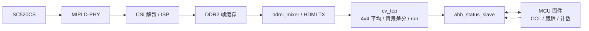

# camera_hdmi_720p 实施计划与最终状态

## 1. 目标

在 PH1P35MDG324 开发板上实现 SC520CS 摄像头钢珠检测：

- 摄像头 1280×720@60，MIPI 2-lane RAW10
- HDMI 1280×720@60 显示
- 检测在 320×180 小图运行
- 统计钢珠从右向左穿过门线的次数
- 支持最多 7 个同时可见钢珠，硬件容量 8 个轨迹

## 2. 当前架构



FPGA 负责像素前端、run 提取、门线绘制和 overlay；MCU 负责 CCL、筛选、碎块合并、跟踪、门线计数、背景重采和相机曝光/增益。

## 3. 已完成功能

| 功能 | 状态 |
|---|---|
| 摄像头 720p60 采集与 HDMI 显示 | 完成 |
| DDR2 4 帧乒乓缓存 | 完成 |
| 4×4 G 平均到 320×180 | 完成 |
| 背景差分与 run_mem | 完成 |
| MCU union-find CCL | 完成 |
| 面积/宽高/填充率/长短比筛选 | 完成 |
| 碎块合并 | 完成 |
| a-b 跟踪与右向左门线计数 | 完成 |
| 5 位 BCD 数码管与 HDMI Count | 完成 |
| MiSans OSD（Logo / 标题 / 赛事文本 / FRAME） | 完成 |
| `DETECTED N` 当前框数 | 完成 |
| 门线视频叠加 | 完成 |
| K1 长按清零 Count 和轨迹 | 完成 |
| K2 长按重采背景 + 数码管横线 | 完成 |
| MCU 控制曝光/增益 | 完成 |
| UI 布局编辑器 | 完成 |
| 参数交互演示 | 完成 |
| 单页逐帧视频查看器 | 完成 |

## 4. 当前发布参数

```text
enable=1
exposure=768      gain=64
bg_thr=80         min_run=2
bg_capture_delay=120
bg_settle_frames=10
bg_recalc_settle_frames=30

min_area=100      max_area=2000
min_w=18          max_w=100
min_h=5           max_h=50
min_fill=0        min_ratio=0
edge_margin=0
merge_dist=20
max_run_len=200

box_w_small=43
gate_x=100
gate_y0=0
gate_y1=180
roi_y1=180

track_gate=55
max_miss=5
min_hits=2
min_move=5
min_window=21
vx_max=-1
static_max_age=30

debug=1
debug_div=30
```

当前门线位置：

```text
x = 100 × 4 = 400 全分辨率像素
y = 0 … 720
```

## 5. 寄存器

| 偏移 | 名称 | 说明 |
|---:|---|---|
| `0x00` | `CAM_REG` | 摄像头和板级状态 |
| `0x04` | `CV_REG` | bin_thr / run_cnt / 帧计数 |
| `0x08` | `FRAME_REG` | vsync 帧计数 |
| `0x0C` | `VER_REG` | `0x4D435602` |
| `0x10` | `HEARTBEAT` | 心跳 |
| `0x14` | `SCRATCH` | 调试暂存 |
| `0x18` | `RUN_IDX` | run_mem 读索引 |
| `0x1C` | `RUN_DAT` | run_mem 数据 |
| `0x20` | `OV_IDX` | overlay 索引 |
| `0x24` | `OV_W0` | overlay 高 32 位 |
| `0x28` | `OV_W1` | overlay 低 32 位，写入提交 |
| `0x2C` | `META_REG` | run_cnt / min_y / max_y |
| `0x30` | `OV_COUNT` | 计数值 |
| `0x34` | `BALL_CTRL` | `[0]=enable [1]=capture` |
| `0x38` | `BALL_THR` | `[7:0]=bg_thr [15:8]=min_run` |
| `0x3C` | `BALL_STATUS` | bg_ready / capturing / run_overflow |
| `0x40` | `SW_STAT` | SW1..SW4 |
| `0x44` | `BCD_COUNT` | 5 位 BCD |
| `0x48` | `BALL_RUN_CFG` | roi_y1 / max_run_len |
| `0x4C` | `SKIP_CNT` | ROI 与超长 run 丢弃计数 |
| `0x50` | `KEY_EVT` | K1/K2 长按事件 |
| `0x54` | `BALL_NOW` | 当前绿框数 |
| `0x58` | `SEG_CTRL` | 数码管全横线 |
| `0x5C` | `BALL_GATE` | gate_x / gate_y0 / gate_y1 |
| `0x60` | `CAM_AE` | 曝光目标 |
| `0x64` | `CAM_AG` | 增益目标 |

## 6. 发布产物

```text
bit: camera_hdmi_720p_ae_mcu_E93577E7.bit
MD5: E93577E71A445D475698BA80A714343B

elf: ph1p35_status_tune_gate100_E6DFDDC8.elf
MD5: E6DFDDC8E784C607C1192C3459FC97DF
```

时序与资源：

```text
Setup WNS +0.140 ns
Hold  WNS +0.020 ns
0 violations
Slices 16,940 / 21,216 (79.85%)
RAM    69 / 108
DSP    10 / 40
```

## 7. 性能边界

- 相机配置固定 1280×720@60
- FPGA 像素通路 75 MHz，单像素每时钟
- HDMI 输出 720p60
- 完整 720p120 需要 148.5 MHz 或双像素通路，当前结构不满足
- 检测 120 fps 可使用 640×360@120 或 ROI 120，需要新的传感器寄存器表和视频输入配置
- 运动拖影由曝光时间决定，当前曝光约 6.4 ms，增加补光后可以继续缩短

## 8. 后续可选项

- 3×3 形态学开运算，改善钢珠高光造成的空洞和碎片
- 大尺寸连通域拆分，处理两个球重叠
- 常数速度预测，降低轨迹关联失败
- `run_mem` 深度或标签容量扩展，需重新综合
- 参数保存到 Flash，掉电保留现场调参
- 看门狗和摄像头/DDR/HDMI 异常恢复
- 120 fps 检测通路

## 9. 关键文档

- `README.md`：项目概览和使用说明
- `docs/TECHNICAL_DETAILS.md`：模块、时钟、数据通路、寄存器、构建与验证
- `mcu_fw/README.md`：固件参数、串口协议、调参流程
- `tools/ui_layout/README.md`：OSD 布局编辑器
- `tools/vision_demo/README.md`：参数交互演示
- `docs/hardware/HW_MCU.md`：MCU 平台和 AHB 窗口
- `docs/hardware/HW_SC520CS.md`：SC520CS 摄像头参数
