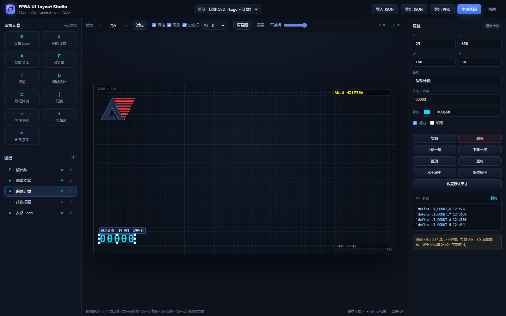

# FPGA UI Layout Studio

面向 `work/camera_hdmi_720p` 的 **1280 × 720 OSD / UI 可视化排布器**。纯静态网页，无依赖，双击 `index.html` 即可使用（Edge / Chrome）。



## 能做什么

- 11 种可放置元素：安路 Logo、钢珠计数、OSD 文本、帧计数、标签、调试统计、球框样例、门线、检测 ROI、十字准线、彩条。
- 拖拽移动，或右侧直接输入 `X / Y / W / H` 精确排版。
- 网格吸附、元素边缘/中心对齐吸附、画布中心吸附；按住 `Alt` 临时关闭吸附。
- 8 个缩放手柄；`Shift` 拖拽锁定单轴。
- 图层顺序、显示/隐藏、锁定、水平/垂直居中、恢复默认尺寸。
- 撤销/重做、复制、删除、键盘微调。
- 载入预设：当前 RTL、比赛 OSD、调试叠加、空白画布。
- 背景图仅用于预览（不导出），可调透明度。
- 导出 JSON / Verilog `.vh` / C `.h` / PNG 预览图。
- 自动保存到浏览器 `localStorage`，刷新不丢。

## 快速开始

1. 双击打开 `index.html`。
2. 在顶部“预设”里选一套布局，或从左侧添加元素。
3. 拖拽或输入坐标；右侧会实时显示对应的 RTL 参数。
4. 点“生成代码”，复制或下载 `ui_layout.vh` / `ui_layout_regs.h` / `ui_layout.json`。
5. 需要写回 RTL 时，用 `apply_layout.py`（见下）。

## 快捷键

| 操作 | 快捷键 |
|---|---|
| 移动 1px / 10px | 方向键 / `Shift` + 方向键 |
| 复制 | `Ctrl/Cmd + D` |
| 删除 | `Delete` / `Backspace` |
| 撤销 / 重做 | `Ctrl/Cmd + Z` / `Ctrl/Cmd + Y` |
| 导出 JSON | `Ctrl/Cmd + S` |
| 取消选择 / 关闭弹窗 | `Esc` |
| 缩放 | `Ctrl` + 滚轮 |
| 临时关闭吸附 | 拖拽时按住 `Alt` |

## 导出格式

### JSON

`ui_layout.json` 是工具的完整工程文件，可再次导入：

```json
{
  "app": "fpga-ui-layout-studio",
  "version": 1,
  "canvas": { "width": 1280, "height": 720 },
  "elements": [
    {
      "id": "el_xxx",
      "type": "count",
      "name": "钢珠计数",
      "x": 24, "y": 638, "w": 150, "h": 34,
      "color": "#00e6ff",
      "text": "00000",
      "visible": true,
      "locked": false
    }
  ]
}
```

### Verilog `ui_layout.vh`

```verilog
`define UI_CANVAS_W 12'd1280
`define UI_CANVAS_H 12'd720
`define UI_ELEM_COUNT 5

`define UI_LOGO_X 12'd24
`define UI_LOGO_Y 12'd24
`define UI_LOGO_W 12'd120
`define UI_LOGO_H 12'd120
...
`define UI_COUNT_X 12'd24
`define UI_COUNT_Y 12'd638
...
`define UI_EL0_X 12'd24
...
```

同名类型重复时自动加后缀：`UI_LOGO_2_X`、`UI_COUNT_2_Y`。每个元素同时有 `UI_EL<index>_*` 通用宏。

### C `ui_layout_regs.h`

```c
#define UI_CANVAS_W 1280
#define UI_COUNT_X 24
#define UI_COUNT_Y 638
#define UI_COUNT_W 150
#define UI_COUNT_H 34
```

## 与当前 RTL 的对应关系

| 工具元素 | RTL 参数 | 当前状态 |
|---|---|---|
| 安路 Logo | `hdmi_mixer.v` → `LOGO_X / LOGO_Y` | X/Y 可直接写回；Logo ROM 固定 160×160，W/H 仅预览 |
| 钢珠计数 | `cv_top.v` → `CNT_X / CNT_Y` | X/Y 可直接写回；5×7 字模、每位 8px，W/H 仅预览 |
| OSD 文本 | `hdmi_mixer.v` → `DYN_OSD_X / DYN_OSD_Y` | X/Y 可直接写回；W/H 仅预览 |
| 门线 | 检测逻辑固定 `x = 0.30 × 1280 = 384` | 仅预览，移动不会改变检测 |
| 检测 ROI | MCU `roi_y1`（小分辨率 166 → 全分辨率 664） | 仅预览 |
| 球框 | 运行时动态叠加 | 仅样例 |
| 帧计数 / 标签 / 调试统计 / 十字 / 彩条 | 固件或后续功能 | 规划位置用 |

> 24×24 MiSans 字库接入后，Count / OSD 的 `W/H` 才会真正参与字模缩放；当前 RTL 仍是 5×7 与 16×16 字模。

## 写回 RTL：apply_layout.py

导出的 JSON 可以直接把 **Logo / Count / OSD 的 X/Y** 写回 RTL：

```powershell
# 先看会改什么（推荐）
python tools/ui_layout/apply_layout.py path/to/ui_layout.json --dry-run

# 确认后写回
python tools/ui_layout/apply_layout.py path/to/ui_layout.json
```

脚本只替换 `localparam ... = 12'dN;` 中的数字，保留 CRLF 和其余格式；不会改 W/H，也不会动门线/ROI。写回后需要重新综合：

```text
syn_1 -> phy_1 -> 新 bit -> 上板
```

## 预设说明

| 预设 | 内容 |
|---|---|
| 当前 RTL 布局 | Logo `(0,0,160,160)`，动态 OSD `(375,120,200,24)`，Count `(24,56,40,7)` |
| 比赛 OSD（Logo + 计数） | Logo 左上 160×160，Count 左下 150×34，右上赛事文本，右下帧计数 |
| 调试叠加 | ROI、门线 x=384、左上 Count、调试统计、球框样例、十字 |
| 空白画布 | 清空 |

示例文件在 `examples/`，可直接“导入 JSON”。

## 说明 / 限制

- 预览里的“安路 Logo”由 `anlogic_logo_rom.v` 导出的 160×160 PNG（`logo_anlogic.png`）渲染，透明底；实际 OSD 仍是同一 Logo ROM。
- Logo 的 W/H 只改变预览缩放，不会缩放 RTL 的 160×160 ROM；写回脚本只应用 X/Y。
- PNG 导出会临时关闭网格/安全框/选择框，输出 1280×720 纯画面。
- 背景图只存在浏览器内存，不写入 JSON，也不参与导出。
- 当前 OSD 在钢珠识别模式下被整体关闭（`S_osd_on` 的 gating），因此 Count 位置会生效，但 Logo 是否显示取决于后续的 Logo/OSD 独立开关。
- 坐标按 12-bit 无符号处理，范围 0…4095；画布内元素不会出现负数坐标。

## 文件

```text
tools/ui_layout/
├─ index.html          # 页面结构
├─ style.css           # 深色 UI
├─ app.js              # 编辑器 / 渲染 / 导出
├─ apply_layout.py     # JSON -> RTL X/Y
├─ logo_anlogic.png    # 从 Logo ROM 导出的 160×160 预览图
├─ preview.png         # 完整界面截图
├─ preview_canvas.png  # 纯画面预览（1280×720）
└─ examples/
   ├─ current.json
   ├─ competition.json
   └─ debug.json
```

## 控制台 API

页面加载后可在 DevTools Console 里用：

```js
FPGAUILayout.preset('competition');
FPGAUILayout.design;          // 当前布局对象
FPGAUILayout.json();          // JSON 文本
FPGAUILayout.verilog();       // .vh 文本
FPGAUILayout.cHeader();       // .h 文本
FPGAUILayout.select(id);      // 选中元素
FPGAUILayout.exportPng();     // 下载 PNG
```
