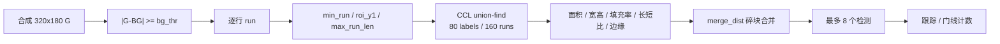

# Vision Parameter Lab

钢珠算法的交互式参数演示。使用 320×180 binned G 图像，把 `VISION_PARAMS` 中的阈值、几何和跟踪参数直接可视化。

## 打开

```text
work/camera_hdmi_720p/tools/vision_demo/index.html
```

纯静态页面，无依赖，Edge / Chrome 离线可用。

## 算法链



演示逻辑与 `mcu_fw/main.c` 的 CCL、筛选、合并、跟踪、门线计数保持一致。`roi_y1`、`max_run_len`、`min_run` 在 run 提取阶段过滤。

## 界面

- 左栏：前端、Blob 筛选、合并、几何、跟踪、启动、场景参数
- 中间画面：
  - 绿色横线：保留的 run
  - 红色横线：被 ROI、长度或 min_run 丢弃的 run
  - 蓝框：通过筛选的 Blob
  - 红虚线框：被拒绝的 Blob
  - 黄框：可见轨迹
  - 灰框：未确认或丢失轨迹
  - 粉色虚线：门线
  - 青色虚线：ROI 底边
  - HUD：帧号、Count、run 数、skip 数、Blob 数、轨迹数
- 右栏：当前参数说明、建议值、Blob 明细、轨迹明细
- 顶部：播放、暂停、单步、重置、场景、速度、工具开关

## 当前参数

| 参数 | 当前值 |
|---|---:|
| `bg_thr` | 80 |
| `min_run` | 2 |
| `roi_y1` | 180 |
| `max_run_len` | 200 |
| `min_area` / `max_area` | 100 / 2000 |
| `min_w` / `max_w` | 18 / 100 |
| `min_h` / `max_h` | 5 / 50 |
| `min_fill` / `min_ratio` | 0 / 0 |
| `edge_margin` | 0 |
| `merge_dist` | 20 |
| `box_w_small` | 43 |
| `gate_x` | 100 |
| `gate_y0` / `gate_y1` | 0 / 180 |
| `track_gate` | 55 |
| `max_miss` | 5 |
| `min_hits` | 2 |
| `min_move` | 5 |
| `min_window` | 21 |
| `vx_max` | -1 |
| `static_max_age` | 30 |
| `bg_capture_delay` | 120 |
| `bg_settle_frames` | 10 |
| `bg_recalc_settle_frames` | 30 |

`exposure`、`gain`、`K2` 背景重采和数码管横线属于固件/硬件行为，演示页不逐帧模拟。

## 场景预设

| 预设 | 用途 |
|---|---|
| 标准 7 球 + 底堆 | 运动球、静止球、高光分裂、底部球堆、长条、噪声 |
| 干净 3 球 | 观察 CCL 和跟踪 |
| 噪声 / 碎片 | 观察 `min_run`、面积、宽高、填充率、长短比 |
| 反向滚动 | 验证门线方向，右到左才计数 |
| 静止球 | 观察 `static_max_age`、`min_move`、`min_window` |
| 长条干扰 | 观察 `max_run_len`、`max_w` |

## 参数分组

- 前端 / run：`enable`、`bg_thr`、`min_run`、`roi_y1`、`max_run_len`
- Blob 筛选：`min_area`、`max_area`、`min_w`、`max_w`、`min_h`、`max_h`、`min_fill`、`min_ratio`、`edge_margin`
- 碎块合并：`merge_dist`
- 几何 / 门线：`box_w_small`、`gate_x`、`gate_y0`、`gate_y1`
- 跟踪 / 计数：`track_gate`、`max_miss`、`min_hits`、`min_move`、`min_window`、`vx_max`、`static_max_age`
- 启动时序：`bg_capture_delay`、`bg_settle_frames`、`bg_recalc_settle_frames`
- 场景：`sensorNoise`、`ballG`

## 结构参数

| 参数 | 值 | 含义 |
|---|---:|---|
| `MAX_RUNS` | 1024 | 整帧 run_mem 深度 |
| `MAX_PREV` | 160 | 单行 CCL 工作区 |
| `MAX_LABELS` | 80 | 连通域标号上限 |
| `MAX_DET` | 8 | 每帧检测数 |
| `MAX_TRK` | 8 | 同时轨迹数 |
| `BALL_W × BALL_H` | 320×180 | 4×4 平均后的小图 |

这些是综合期常量，修改后需要重新综合 FPGA。

## 限制

- 演示在 320×180 binned G 上计算，不模拟 4×4 平均、MIPI、ISP、DDR、HDMI
- 场景为合成图像，不包含真实相机噪声
- 跟踪参数按每帧定义，修改顶部 FPS 会改变运动速度
- 参数即时预览在暂停时重算 run、CCL、筛选；跟踪状态需要单步或播放
- 启动时序参数只在参数表显示，不参与逐帧画面
- 最终结果以板上 bit 和 ELF 为准

## 文件

- `index.html`
- `style.css`
- `app.js`
- `preview.png`
- `README.md`
